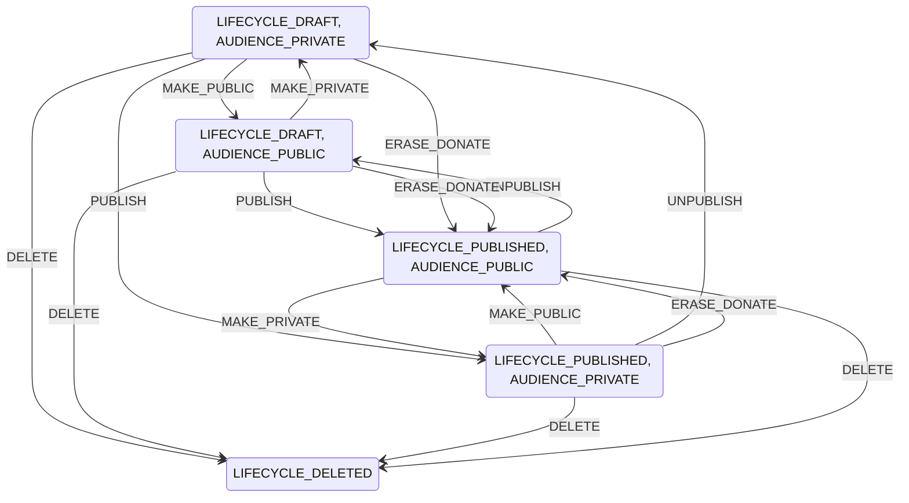
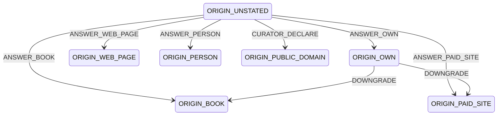
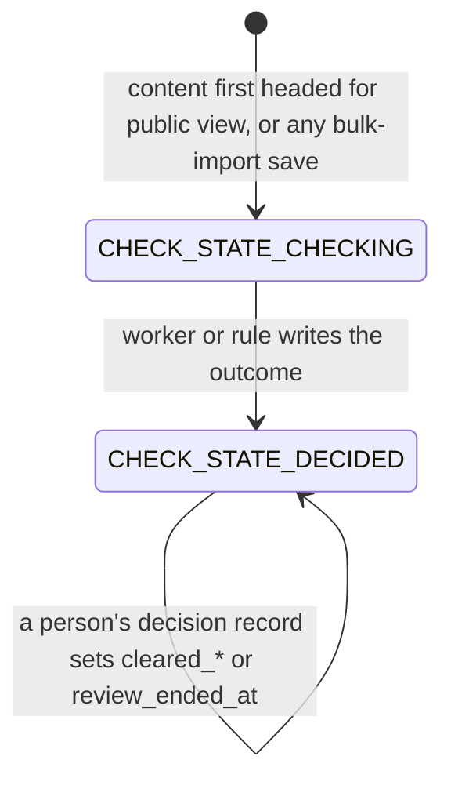

# The recipe state model

This is the one authority for what state a recipe can be in, how it moves between states, and what each state is
called. Specs and ADRs cite it and do not restate it. The decisions behind it are
[ADR-0097](decisions/0097-a-recipe-has-one-state-model-and-only-commise-changes-a-confirmed-source.md) (the rulings),
[ADR-0103](decisions/0103-the-recipe-state-model-is-code-and-staff-can-clear-the-correction-hold.md) (the code is the
source, and staff can clear the correction hold) and
[ADR-0104](decisions/0104-a-recipe-stores-its-origin-in-one-column.md) (one origin column).
The same values, labels, refusal reasons and retired names are in [`recipeStateModel.json`](recipeStateModel.json),
which guards read.

The file holds no legal reasoning. Rules are written as product behaviour.

Every value has an internal name in UPPER_SNAKE and, where a person reads it, a localised string.

Contents:

1. Scope
2. How this document is kept
3. Open items
4. The unified model: names, stored values, labels
5. State graphs, the creation table and the planned list
6. Retired names
7. Codifying it
8. Decisions recorded

## 1. Scope

- **In the registry:** every label a cook or reader can see about a recipe's state, whatever machine produces it.
- **In the state graph:** the recipe's own axes only.
- **Separate machines** get their own namespace and a pointer (4.10). Their states are not recipe states. Their
  cook-facing strings still enter the registry.
- **Out of scope:** foods, collections, household lists and the cooking session. They appear only in 4.10 and in the
  naming rule, which reserves their prefixes.
- **Not owned here:** the read rule. ADR-0074 §1 owns it as one Specification. This model owns transitions, refusals,
  derived labels and names, and it cites the Specification.
- **Not owned here:** generic snackbars and undo outcomes. Each "removed" snackbar key keeps its own owner. None is a
  recipe state.

## 2. How this document is kept

- The code is the source (ADR-0103). The tables and mermaid blocks between `<!-- recipeState:begin ID -->` and
  `<!-- recipeState:end ID -->` markers are written by the generator in `packages/tools/recipeStateDoc`, together with
  `recipeStateModel.json`. CI fails on a diff. The prose stays hand-written.
- The module (`packages/shared/recipe-core/src/recipeState/`) and the generator came with the build plan's PR 2. The
  tables between markers and the JSON are generated from them: edit the module, or the document's own words in the
  generator's `docProse.ts`, and run `npm run recipeState:generate`. CI runs `npm run recipeState:verify`.
- A planned item is marked `pending` with the work that builds it. Nothing at runtime reads a planned item.
- **Halfway state, on purpose.** The module is built and tested, and the service does not call `nextState` yet. PR 2b
  (wire) wires it, adds the server parity test, renames the wire reasons with the dual accept, and deletes the
  client's own ordering. Until then the recipe page asks `refusalOf` through `publicRefusalOf` and the service keeps its
  own policy.
- In the JSON, a refusal has a `reason` and a `name`, the `REFUSAL_*` name (4.5). The reasons main uses today are the `PUBLIC_REFUSALS` constant in `publicRefusal.ts`, which `publicRefusalNames.test.ts` holds to this list. The other `reason` values are new names. The
  `reason` values move to the `REFUSAL_*` names when the code does.

## 3. Open items

1. **The hold-clear record shape** (4.6.1). staff-architect BLUEPRINT settles it before the code (PR 5).
2. **Report abuse.** Any signed-in cook can hide a public version at once. 020's plan owns the per-cook report limit
   and the review queue. The designer writes the limit's refusal line (4.8.1).
3. **The final words of `HOLD_REMOVED`.** 016 owns them (4.6).

## 4. The unified model

### 4.1 Naming rule (decided, section 8)

- Every value has one **internal name** in UPPER_SNAKE. It is unique across the whole registry.
- **Recipe names take an axis prefix:** `ORIGIN_WEB_PAGE`, `HOLD_SOURCE_CORRECTED`, `REFUSAL_FROM_PERSON`.
- **Other objects take an entity prefix:** `COLLECTION_AUDIENCE_PRIVATE`, `CIRCLE_AUDIENCE_PUBLIC`.
- **`FOOD_*` is reserved** for the follow-up that applies this registry to foods. Nothing else uses it.
- **Separate machines take a machine prefix** (4.10). `HELD`, `WITHDRAWN` and `CLEARED` appear only inside a prefix.
- The internal name is the const key in recipe-core. The value is the stored string, the way
  `RecipeStatus.DRAFT = 'draft'` works today.
- The refusal reason on the wire (`details.reason`) becomes the `REFUSAL_*` name. The contract is regenerated with
  `contract:generate`. This is a one-way door once a client ships.

### 4.2 Stored-value types (one `as const` object each, values are the stored strings)

<!-- recipeState:begin 4.2-1 -->

| Type                         | Stored in                                         | Values                                                                                                                                                                                                                                         | Built                                      |
| ---------------------------- | ------------------------------------------------- | ---------------------------------------------------------------------------------------------------------------------------------------------------------------------------------------------------------------------------------------------- | ------------------------------------------ |
| `Lifecycle`                  | `recipes.status`, `deleted_at`                    | `LIFECYCLE_DRAFT`='draft', `LIFECYCLE_PUBLISHED`='published'. `LIFECYCLE_DELETED` is `deleted_at IS NOT NULL`                                                                                                                                  | yes                                        |
| `Audience`                   | `recipes.visibility`                              | `AUDIENCE_PRIVATE`='private', `AUDIENCE_PUBLIC`='public'                                                                                                                                                                                       | yes                                        |
| `Origin`                     | `recipes.origin`, one column (4.2.1)              | `ORIGIN_UNSTATED`='unstated', `ORIGIN_OWN`='own', `ORIGIN_WEB_PAGE`='webPage', `ORIGIN_BOOK`='book', `ORIGIN_PAID_SITE`='paidSite', `ORIGIN_PERSON`='person', `ORIGIN_PUBLIC_DOMAIN`='publicDomain', `ORIGIN_COMMISE_WRITTEN`='commiseWritten' | PR 3. `COMMISE_WRITTEN` is written by 003B |
| `SourceConfirmation`         | `recipes.source_confirmed_at` (ratchet, mig 0092) | `SOURCE_UNCONFIRMED` (NULL), `SOURCE_CONFIRMED` (set)                                                                                                                                                                                          | yes                                        |
| `EvidenceCapture`            | `recipe_source_evidence.capture` (append-only)    | `EVIDENCE_PASTED_PAGE`='pastedPage', `EVIDENCE_EDITOR_LINK`='editorLink', `EVIDENCE_EDITOR_CITATION`='editorCitation', `EVIDENCE_IMPORT_FILE`='importFile', `EVIDENCE_STAFF_CORRECTION`='staffCorrection'                                      | yes                                        |
| Holds                        | one stored fact per hold (4.6)                    | `HOLD_SOURCE_CORRECTED`, `HOLD_HIDDEN_AFTER_REPORT`, `HOLD_REMOVED`                                                                                                                                                                            | one built                                  |
| `CheckState`, `CheckOutcome` | `recipe_source_checks` (020)                      | 4.7                                                                                                                                                                                                                                            | pending: 020                               |
| `CheckDecisionKind`          | `recipe_source_decisions.kind` (020)              | 4.7                                                                                                                                                                                                                                            | pending: 020                               |
| `StepsCredit`                | per version (027)                                 | `STEPS_BY_COOK`, `STEPS_BY_AI`, `STEPS_BY_COMMISE`                                                                                                                                                                                             | pending: 027                               |
| `RewrittenFact`              | `rewritten_fact` (P4a)                            | `REWRITTEN_ABSENT`='absent', `REWRITTEN_BY_COOK`='earnedByCook', `REWRITTEN_BY_AI`='earnedByAi'                                                                                                                                                | package on main, rest P4                   |
| Clone link                   | `recipes.cloned_from_id`                          | a foreign key, not an enum. Read as a fact                                                                                                                                                                                                     | yes                                        |

<!-- recipeState:end 4.2-1 -->

#### 4.2.1 The origin column

- `recipes.origin text NOT NULL DEFAULT 'unstated'`, with a CHECK on the eight values above. "Unstated" is a value,
  not NULL, so every row names its origin.
- The column replaces `source_type`, `source_kind` and `statement_kind` on `recipes`. ADR-0104 says how it lands.
- `publicDomain` is written only with the grant `recipes:import:public` (DD18, ADR-0023).
  `commiseWritten` is written only by the 003B publish (5.7).
- **Kept as they are:** the attestation `choice`, the import item `statement_kind` and the evidence `source_kind`.
  These are answer words or facts about one piece of evidence. One codec in recipe-core maps an answer to an origin.
- **The wire is unchanged.** The codec maps `origin` to today's wire fields. A wire change is its own decision.

### 4.3 Codec and derived types (never stored)

| Type          | Values                                                                                                                                                                                         | Computed from                                                                               | Where       |
| ------------- | ---------------------------------------------------------------------------------------------------------------------------------------------------------------------------------------------- | ------------------------------------------------------------------------------------------- | ----------- |
| `OriginRead`  | every `Origin` value plus `ORIGIN_UNRECOGNISED`                                                                                                                                                | the wire codec. It is the result for a wire value this build does not know. It fails closed | client only |
| `SourceFacts` | `contentPasted` (from `content_pasted_at`), `evidence` (the capture list), `evidenceHoldsPublic` (from the evidence rule, `sourceConflictOf`), `clonedFrom`, `confirmed`, `attestedFromPerson` | the row, and the attestation table                                                          | both        |
| `SourceLock`  | `SOURCE_LOCK_OPEN`, `SOURCE_LOCK_DOWNGRADE_ONLY`, `SOURCE_LOCK_LOCKED`                                                                                                                         | the existing `sourceLockOf`                                                                 | both        |
| `PrivateRule` | `PRIVATE_RULE_SLOTS`, `PRIVATE_RULE_PRIVATE_ONLY`                                                                                                                                              | the existing `privateRuleOf`                                                                | both        |
| Views         | 4.8                                                                                                                                                                                            | the stored facts plus the hold Specification's exported predicates                          | both        |
| `Refusal`     | 4.5                                                                                                                                                                                            | `refusalOf(facts)`                                                                          | both        |

### 4.4 Labelled stored values

| Internal name            | en label                                                                      | Key                                                    | Viewer               |
| ------------------------ | ----------------------------------------------------------------------------- | ------------------------------------------------------ | -------------------- |
| `LIFECYCLE_DRAFT`        | Draft                                                                         | `LIFECYCLE_DRAFT` (string of `recipe.card.draftBadge`) | owner                |
| `LIFECYCLE_PUBLISHED`    | none (no chip)                                                                | none                                                   |                      |
| `LIFECYCLE_DELETED`      | none. The toast keeps `detailActions.recipeDeleted` "Recipe deleted"          | none                                                   |                      |
| `AUDIENCE_PRIVATE`       | Private                                                                       | `AUDIENCE_PRIVATE`                                     | owner                |
| `AUDIENCE_PUBLIC`        | Public                                                                        | `AUDIENCE_PUBLIC`                                      | owner                |
| `ORIGIN_UNSTATED`        | none                                                                          | none                                                   |                      |
| `ORIGIN_OWN`             | owner "Written by you". Reader "Written by {cook}"                            | `ORIGIN_OWN.owner`, `ORIGIN_OWN.reader`                | both                 |
| `ORIGIN_WEB_PAGE`        | From a web page. With a site, where there is no "Source" heading: From {site} | `ORIGIN_WEB_PAGE`, `ORIGIN_WEB_PAGE.withSite`          | owner (private only) |
| `ORIGIN_BOOK`            | From a cookbook or magazine                                                   | `ORIGIN_BOOK`                                          | owner (private only) |
| `ORIGIN_PAID_SITE`       | From a paid website                                                           | `ORIGIN_PAID_SITE`                                     | owner (private only) |
| `ORIGIN_PERSON`          | From another person                                                           | `ORIGIN_PERSON`                                        | owner (private only) |
| `ORIGIN_PUBLIC_DOMAIN`   | Public domain                                                                 | `ORIGIN_PUBLIC_DOMAIN`                                 | any                  |
| `ORIGIN_COMMISE_WRITTEN` | Written by Commise                                                            | `ORIGIN_COMMISE_WRITTEN`                               | any                  |

- **"Written by Commise" never shows alone.** It always shows with the AI line: `credit.written`, or
  `credit.writtenNoCook` if the credit names no cook. The AI line keeps its words "Steps written by Commise with AI,
  checked by {cook}." It shows with `credit.basedOn` "Based on a recipe at {site}" where 003B FR-018 allows it. A paid
  source names no site, so `credit.basedOn` shows for free sites only (ADR-0093 §4 and §5).
- The answer "I wrote this" (A `sourceStatement.answerAuthored`) is not the label "Written by you". An answer is not
  a label. The sheet's answers keep their own keys (`ANSWER_OWN` and so on).
- **"I wrote this" is the answer.** It shows where the cook gives or reviews their answer: the source sheet, and the
  editor's Source row (`SOURCE_ROW_OWN`, `SOURCE_ROW_LOCKED_ANSWER`). It is first person because the cook is speaking.
- **"Written by you" is the label.** It shows where the app describes the recipe to its owner: the recipe detail page
  and the card, through `RIGHTS_LABEL`. Readers see "Written by {cook}". The two never swap surfaces.
- **`ANSWER_UNSTATED_PRIVATE`** is the sheet answer that publishes the recipe private without naming a source. Its label is "I’m not sure yet" and its hint is "It stays private. You can say where it’s from later." The flow stores no statement and no kind. A planned test ties the hint to `sourceLockOf` returning `open` for this state, so the cook can still answer later. The test also pins the case where a web link stored a kind before the private publish: the lock is `locked` and the hint must not show.
- The hints "Only you can see it" and "Anyone can find it in Discover" stay as hint keys beside the audience label.

### 4.5 Refusals (one enum, `refusalOf` in recipe-core)

Every refusal is a whole sentence in one key. The server sends the internal name in `details.reason` and a fixed
developer message. It builds no user copy.

<!-- recipeState:begin 4.5-1 -->

| Internal name                          | Computed by | Wire today                                                                                                                                                         | en (whole sentence)                                                                                        | Built                                                                                                                                            |
| -------------------------------------- | ----------- | ------------------------------------------------------------------------------------------------------------------------------------------------------------------ | ---------------------------------------------------------------------------------------------------------- | ------------------------------------------------------------------------------------------------------------------------------------------------ |
| `REFUSAL_POLICY_WEB_PAGE`              | both        | 400 `INVALID_VISIBILITY`, no reason today (reason: PR 2b (wire))                                                                                                   | existing key `policyWebPage` ("This recipe stays private because it’s from a web page.")                   | client yes. The server split into three reasons is PR 2b (wire) work, not built (the client derives the three from the stored source until then) |
| `REFUSAL_POLICY_BOOK`                  | both        | 400 `INVALID_VISIBILITY`, no reason today (reason: PR 2b (wire))                                                                                                   | existing key `policyBook`                                                                                  | client yes. The server split into three reasons is PR 2b (wire) work, not built (the client derives the three from the stored source until then) |
| `REFUSAL_POLICY_PAID_SITE`             | both        | 400 `INVALID_VISIBILITY`, no reason today (reason: PR 2b (wire))                                                                                                   | existing key `policyPaidSite`                                                                              | client yes. The server split into three reasons is PR 2b (wire) work, not built (the client derives the three from the stored source until then) |
| `REFUSAL_FROM_PERSON`                  | both        | reason `FROM_PERSON_PRIVATE_ONLY`                                                                                                                                  | existing `fromPerson`                                                                                      | yes                                                                                                                                              |
| `REFUSAL_SOURCE_CONFLICT`              | both        | reason `SOURCE_CONFLICT`                                                                                                                                           | existing `sourceConflict`                                                                                  | yes                                                                                                                                              |
| `REFUSAL_SOURCE_CORRECTED`             | both        | reason `SOURCE_CORRECTED`                                                                                                                                          | This recipe stays private because its source was corrected. (planned in the open source-lock change, #488) | pending: #488, open                                                                                                                              |
| `REFUSAL_STATEMENT_REQUIRED`           | both        | reason `STATEMENT_REQUIRED`                                                                                                                                        | Say where this recipe is from before making it public.                                                     | new client key                                                                                                                                   |
| `REFUSAL_PUBLIC_CONFIRMATION_REQUIRED` | server      | reason `PUBLIC_CONFIRMATION_REQUIRED`                                                                                                                              | the Publish sheet (4.9)                                                                                    | yes                                                                                                                                              |
| `REFUSAL_API_WRITER_CONFIRMATION`      | server      | reason `API_WRITER_CONFIRMATION_FORBIDDEN`                                                                                                                         | none (API only)                                                                                            | yes                                                                                                                                              |
| `REFUSAL_NO_PRIVATE_SLOT`              | both        | 403 `PRIVATE_SLOTS_FULL`, no reason (reason: PR 2b (wire))                                                                                                         | one key, ICU plural on `{total}` (4.9)                                                                     | merges A `privateRefused.slots` and E `slotsFull`                                                                                                |
| `REFUSAL_SOURCE_LOCKED`                | server      | 403 `FORBIDDEN`, `details.reason` `SOURCE_LOCKED`. The pair maps to the name. In PR 2b (wire) the reason value becomes `REFUSAL_SOURCE_LOCKED` under the same code | the source-lock change (#488, open) adds `lockedRefused`                                                   | pending: #488, open                                                                                                                              |
| `REFUSAL_PRIVATE_FOODS_ON_PUBLIC`      | server      | 400 `PRIVATE_FOODS_ON_PUBLIC_RECIPE`                                                                                                                               | existing editor key                                                                                        | yes                                                                                                                                              |
| `REFUSAL_PUBLISH_REQUIREMENTS`         | both        | 422 `PUBLISH_REQUIREMENTS_UNMET`                                                                                                                                   | existing editor keys                                                                                       | yes                                                                                                                                              |
| `REFUSAL_CONTAINED`                    | server      | 403 `TEST_PRINCIPAL_CONTAINED`, no reason (reason: PR 2b (wire))                                                                                                   | none (no cook meets it)                                                                                    | yes                                                                                                                                              |
| `REFUSAL_CONTENT_NOT_APPROVED`         | server      | 403 `SOURCE_CHECK_NOT_APPROVED`                                                                                                                                    | This recipe stays private because it wasn’t approved to be public.                                         | pending: 020 (ADR-0074 §3a)                                                                                                                      |
| `REFUSAL_SAVE_CANNOT_STAY_PUBLIC`      | server      | 400 `INVALID_VISIBILITY`, `details.reason` 'REFUSAL_SAVE_CANNOT_STAY_PUBLIC', `details.cause`: a `SaveRefusalCause` string (P10 wraps it as `{kind}` at its seam)  | none as a line. The refused-save sheet shows (4.8.2)                                                       | pending: P10 (held source), 020 (too close, not approved)                                                                                        |
| `REFUSAL_PUBLIC_VERSION_COPY`          | both        | 400 `INVALID_VISIBILITY`, `details.reason` `PUBLIC_VERSION_COPY`                                                                                                   | `publicRefusal.publicVersionCopy` (planned key)                                                            | pending: 003B T405. Stays until 021-FR-005                                                                                                       |
| `REFUSAL_UNRECOGNISED`                 | client      | never sent                                                                                                                                                         | existing `unrecognised`                                                                                    | yes                                                                                                                                              |
| `REFUSAL_NONE`                         | both        | not a refusal: the result "no refusal"                                                                                                                             | none                                                                                                       | yes (the client value `none`)                                                                                                                    |

<!-- recipeState:end 4.5-1 -->

The owner-only wire flags. A flag that is absent reads false.

| Model name                                                                      | Wire flag              |
| ------------------------------------------------------------------------------- | ---------------------- |
| `SOURCE_CONFIRMED`                                                              | `sourceConfirmed`      |
| `HOLD_SOURCE_CORRECTED`                                                         | `sourceCorrected`      |
| the statement-required fact                                                     | `publicNeedsStatement` |
| `evidenceHoldsPublic` (a fact, not a hold). It yields `REFUSAL_SOURCE_CONFLICT` | `publicNeedsCheck`     |

A recipe that is "from another person" only by an attestation (no stored statement) keeps `ORIGIN_UNSTATED` and the attestation fact. It is not folded into `ORIGIN_PERSON`, because an attestation is appended to another table with no update to `recipes`. `fromPersonOf` and `recipe_is_from_person` keep the arm `ORIGIN_UNSTATED` and attested. A curator import is `ORIGIN_PUBLIC_DOMAIN` or `ORIGIN_WEB_PAGE` by its kind, never by whether a link is present.

- The top-level codes (`INVALID_VISIBILITY`, `FORBIDDEN`, `PRIVATE_SLOTS_FULL`, `PRIVATE_FOODS_ON_PUBLIC_RECIPE`,
  `PUBLISH_REQUIREMENTS_UNMET`, `TEST_PRINCIPAL_CONTAINED` and the 020 codes) stay. Only `details.reason` takes the
  `REFUSAL_*` names.
- The `REFUSAL_STATEMENT_REQUIRED` line never replaces the source sheet. The sheet opens where it does today, and the line is only the reason text beside it.
- **Dual accept.** An installed mobile client sends and reads the old reason strings. The client accepts both the old
  and the new reason for one release. The server keeps sending the old value until the mobile floor version reads the
  new one (ADR-0103). Every client branch on a reason moves in the same PR, with a test per name that asserts the
  specific line and not the generic error.
  The rename changes `INVALID_VISIBILITY_REASONS` in the service's `apiError.schema.ts` (`contract:generate` copies it to `packages/schemas`) and `SOURCE_LOCKED_REASON` in `recipe.error.ts`. Both move in the same PR as the client branches.
- **Order.** `refusalOf` asks "from another person" before the private-only rule, and the service asks them the other way
  round. The two orders cannot both apply: a recipe with a private-only label and a "from another person" statement is
  not a state the database allows (migration 0087's `fromPerson` shape, and ADR-0104's CHECK on the one origin column), so
  the order is not observable. PR 3 adds the test that this shape is refused.
- The 003B answer codes (I-67) are not recipe refusals. They live under `PUBLIC_VERSION_JOB_*` with one casing.
- Bulk import's write-side refusal for a `detected` item (ADR-0074 §3a, the first) is an `IMPORT_ITEM_*` issue.
- A signed-out reader's Report is not a refusal. It opens the sign-in sheet (4.8.1).

### 4.6 Holds: a set, never one column

A hold is a Commise-imposed fact that keeps a recipe from readers. Holds are independent. A recipe can carry more
than one at once. Each hold is its own stored fact: its own column, or its own row in its owner's decision table. No
column ever holds "the" restriction.

Each hold names its enforcement:

- **Read-rule hide.** The recipe keeps the audience the cook chose. The read rule hides it from readers (ADR-0105).
  Commise never makes a recipe private. The SQL form is `recipe_held_from_readers`: the correction hold, cook-captured
  third-party evidence, or a private-only origin label. Staff-correction evidence rows are ignored by the evidence
  term. Two definitions of "third-party evidence" exist for now: the write side (`recipe_holds_third_party_source`
  and `sourceConflictOf`, which stop a publish) counts every row, and the read side ignores staff rows. PR 5 aligns
  them. 020's `holdSpecification.ts` condition sits beside the function in the same predicates, never inside it.
- **Known window.** Until P8h, the correction writer still sets a recipe private. The model has no such edge. P8h
  closes the window. The CHECK `recipes_held_is_not_public` (migration 0092) stands until PR B drops it.

<!-- recipeState:begin 4.6-1 -->

| Internal name              | Stored                                                                                     | Enforcement                                                                       | Set by                                             | Cleared by                                                                                                                                                             | Owner label                                                                                                                   | Built                 |
| -------------------------- | ------------------------------------------------------------------------------------------ | --------------------------------------------------------------------------------- | -------------------------------------------------- | ---------------------------------------------------------------------------------------------------------------------------------------------------------------------- | ----------------------------------------------------------------------------------------------------------------------------- | --------------------- |
| `HOLD_SOURCE_CORRECTED`    | `recipes.source_correction_hold`                                                           | CHECK `recipes_held_is_not_public`. A clone copies the hold at insert, by trigger | staff correction (`STAFF_CORRECT`)                 | staff, `CLEAR_SOURCE_HOLD`, audited (4.6.1); or the system on an earned rewrite when the answer or the evidence is third-party (`EARNED_REWRITE_CLEARS_HOLD`, planned) | none. `REFUSAL_SOURCE_CORRECTED` carries the copy                                                                             | set: yes. Clear: PR 5 |
| `HOLD_HIDDEN_AFTER_REPORT` | 020's plan decides (one-way door). 016's restriction kind `version_hidden_report` names it | read-rule hide                                                                    | any signed-in cook, `REPORT`, at once (020-FR-082) | staff, on a decision                                                                                                                                                   | `VIEW_HIDDEN_AFTER_REPORT.owner` "Hidden after a report. Only you can see it now.". Reader: `VIEW_HIDDEN_AFTER_REPORT.reader` | pending: 020, 003B    |
| `HOLD_REMOVED`             | 016's plan decides (one-way door)                                                          | read-rule hide                                                                    | staff, on a removal decision (016)                 | staff, on an appeal decision                                                                                                                                           | Key `HOLD_REMOVED`: Removed from public view. Only you can see it now. (placeholder: 016 owns the final words)                | pending: 016          |

<!-- recipeState:end 4.6-1 -->

The public check (4.7) is not in this set. It is ADR-0074's hold, with its own records and its own Specification.

#### 4.6.1 Clearing the correction hold: what changes in the schema

The clear is planned until PR 5 builds it. This section describes the design, and "changes" means changes in that PR.

- **Clearing lifts the hold only** (ADR-0105). It never changes the audience. A private recipe stays private. A public
  recipe is readable again when no other term of the read rule hides it. A cook makes a private recipe public through
  `MAKE_PUBLIC` and every guard `refusalOf` applies.
- **The ratchet trigger changes.** Today `recipes_source_correction_hold_ratchet()` raises on any true to false.
  A new migration replaces the function. It allows true to false only when
  `EXISTS (SELECT 1 FROM recipe_source_hold_clears c WHERE c.recipe_id = NEW.id AND c.xact_id = pg_current_xact_id())`.
  Any other UPDATE that clears the hold still raises. False to true is unchanged. The clear record is either a staff clear or a system clear for an earned rewrite on a third-party answer (ADR-0105). The service inserts the record before
  it updates `recipes`.
- **The clear record.** A new append-only table, `recipe_source_hold_clears`: recipe, staff actor, reason and time, and
  `xact_id xid8 NOT NULL DEFAULT pg_current_xact_id()`. A BEFORE INSERT trigger sets `xact_id`, so no writer supplies
  it. It is append-only by trigger, has a no-truncate trigger as `recipe_source_corrections` does, and is deleted with
  its recipe. It is not a row in `recipe_source_corrections`, because that table's shape is an answer change (old and
  new answer, `ground`). The exact shape is a one-way door at launch: staff-architect BLUEPRINT settles it in PR 5.
- **Erasure.** `actor_account_id varchar(255) NOT NULL` carries the same `erased_` shape CHECK as the correction table.
  The append-only trigger allows exactly the relabel the correction table allows: only the actor changes, from a real
  id to an `erased_` token, only while that account's erasure job is `queued` or `running` (or its test reset is
  `running`), and every other column, `xact_id` included, stays the same. PR 5 adds this relabel to `accountErasureWorker.ts`, beside both correction relabels. The trigger also allows the DELETE that cascades from deleting the recipe, and refuses any other DELETE.
- **Trust.** The database proves only that a clear record for the same recipe was written in the same transaction. The
  grant is checked by the service, not by the database. The service's database role can write both the record and the
  column, so a compromised service can clear a hold, and the record is the evidence. This is the trust model of the
  corrections (ADR-0100).
- **The clone trigger does not change.** A clone made after the clear starts unheld.
- **The clear mirrors the correction's clone hold.** In the same transaction it releases the owner's descendants of the
  recipe, found by the same walk as `holdOwnersClones`. It skips a descendant that has a `recipe_source_corrections`
  row of its own, because that hold has its own cause. It writes one clear record for each recipe it releases.
  Other cooks' clones keep their hold, and each is cleared on its own. Each released recipe keeps its audience, and is readable if nothing else hides it.
- **The column COMMENT changes.** "Never cleared" becomes "cleared only by a staff clear, with a record".
- **Nothing else changes.** The clear does not touch `origin`, `source_confirmed_at`, the evidence or the
  correction records.
- **The route.** `POST /api/v1/recipes/:id/source-correction/hold-clear`, behind the grant `recipes:source:correct`.
  A pure policy returns `forbidden`, `notFound`, `notHeld` or `apply`. The command takes the per-user lock, then
  `FOR UPDATE`, as the correction does.

### 4.7 Public check (spec 020, ADR-0074). Pending: 020

The check result is stored **per content version**. 020's `recipe_source_checks` has one row per
`(recipe_id, content_digest)`. An edit makes a new digest, so it makes a new row. No edge goes back to "unchecked".

| Internal name                                                                                        | Stored                         |
| ---------------------------------------------------------------------------------------------------- | ------------------------------ |
| `CHECK_STATE_CHECKING`, `CHECK_STATE_DECIDED`                                                        | `recipe_source_checks.state`   |
| `CHECK_OUTCOME_CLEAR`, `CHECK_OUTCOME_POSSIBLE`, `CHECK_OUTCOME_DETECTED`, `CHECK_OUTCOME_UNCHECKED` | `recipe_source_checks.outcome` |

A person's decision is a **separate record**, `recipe_source_decisions`. It is kept for 016's period and survives the
recipe.

| Internal name                          | Stored `kind`         |
| -------------------------------------- | --------------------- |
| `CHECK_DECISION_AUTOMATED_HOLD`        | `automatedHold`       |
| `CHECK_DECISION_REFERRAL_CLEARED`      | `referralCleared`     |
| `CHECK_DECISION_REFERRAL_NOT_APPROVED` | `referralNotApproved` |
| `CHECK_DECISION_APPEAL_OVERTURNED`     | `appealOverturned`    |
| `CHECK_DECISION_APPEAL_UPHELD`         | `appealUpheld`        |
| `CHECK_DECISION_AUDIT_RESTRICTION`     | `auditRestriction`    |

None of these has a label. The cook sees the views in 4.8. 020's referral, mode and reason values are a separate
machine (`CHECK_REFERRAL_*`, `CHECK_MODE_*`).

### 4.8 Views and chips

**Six chips.** A recipe shows at most one chip: Draft, Hidden, In review, Checking, Public or Private, in that order of
precedence. A check view or Hidden replaces the audience chip. Public is never shown next to Hidden, Checking or In
review. A held private recipe shows Private, with no line.

| Chip      | Shown when                                                            | Key                                                      |
| --------- | --------------------------------------------------------------------- | -------------------------------------------------------- |
| Draft     | `LIFECYCLE_DRAFT`, whatever the audience                              | `LIFECYCLE_DRAFT`                                        |
| Hidden    | published, public, and held from readers (4.6). Owner only            | `VIEW_HIDDEN`                                            |
| In review | published, and in review by `IN_REVIEW_SQL` or its TS twin            | `VIEW_IN_REVIEW` (also replaces `publicExists.inReview`) |
| Checking  | published, public, current content not yet allowed, and not in review | `VIEW_CHECKING`                                          |
| Public    | published, public, current content allowed by `sourceCheckAllows`     | `AUDIENCE_PUBLIC`                                        |
| Private   | published, private                                                    | `AUDIENCE_PRIVATE`                                       |

Until 020 ships, there is no check term, and the Checking and In review chips never show. "Allowed" and "in review"
come only from the predicates `holdSpecification.ts` exports. `chipOf` calls them. It never restates them.

**Lines and other views:**

| Internal name               | From                                                                                                                                                                          | Owner en                                                              | Reader en                 | Key shape          |
| --------------------------- | ----------------------------------------------------------------------------------------------------------------------------------------------------------------------------- | --------------------------------------------------------------------- | ------------------------- | ------------------ |
| `VIEW_HIDDEN_REASON.*`      | the recipe is public and held from readers: `.heldSource` (a recorded source), `.sourceCorrected` (`HOLD_SOURCE_CORRECTED`), `.tooClose`, `.afterCheck`, `.notApproved` (020) | the line of 4.8.2                                                     | none                      |
| `VIEW_ADAPTED_BY_COOK`      | third-party origin + `REWRITTEN_BY_COOK`, or own or unstated origin + `REWRITTEN_BY_COOK` earned through the unblock (ADR-0097 D3)                                            | Adapted by you                                                        | Adapted by {cook}         | owner + reader     |
| `VIEW_COPY_OF`              | clone link to a cook's recipe                                                                                                                                                 | Copied from {name}                                                    | Copied from {name}        | one string         |
| `VIEW_COPY_OF_COMMISE_PAGE` | clone link to an `ORIGIN_COMMISE_WRITTEN` page                                                                                                                                | Copied from a recipe Commise wrote                                    | same                      | one string         |
| `VIEW_CHANGES_ON_DEVICE`    | the device copy is ahead of the server                                                                                                                                        | Changes saved on this device (reuses `editor.status.changesOnDevice`) | none                      | one string         |
| `VIEW_HIDDEN_AFTER_REPORT`  | `HOLD_HIDDEN_AFTER_REPORT` set                                                                                                                                                | `publicPage.hiddenOwner`                                              | `publicPage.hiddenReader` | owner + reader     |
| `SOURCE_HEADING`            | detail page heading over the source link                                                                                                                                      | Source                                                                | same                      | one string         |
| `RIGHTS_LABEL`              | one origin label, or `VIEW_ADAPTED_BY_COOK` when the row above applies                                                                                                        | the chosen label                                                      | the chosen label          | as the chosen name |
| `SLOT_USE`                  | private + published + not deleted (ADR-0073)                                                                                                                                  | slot copy, 4.9                                                        | none                      | ICU plural         |

- `{cook}` and `{name}` come from `bylineOf`. They render the display name and never an `@handle`. An erased account reads "a former member".
  "Commise" never goes into `{name}`, because there it reads like a cook.
- A copy line never says "Cloned". It never says "Adapted from" for an unedited copy. An edited copy that earns the
  rewritten fact shows `VIEW_ADAPTED_BY_COOK` instead.
- `VIEW_ADAPTED_BY_COOK` has owner and reader forms of its headings. A recipe that earns the fact can go public (P4),
  so a reader sees the heading.

<!-- recipeState:begin 4.8-1 -->

| Name                                    | Owner (en)                                 | Reader (en)                                   |
| --------------------------------------- | ------------------------------------------ | --------------------------------------------- |
| `.heading` (over the citation and link) | Adapted by you from                        | Adapted by {cook} from                        |
| `.headingNoCitation.book`               | Adapted by you from a cookbook or magazine | Adapted by {cook} from a cookbook or magazine |
| `.headingNoCitation.paidSite`           | Adapted by you from a paid website         | Adapted by {cook} from a paid website         |
| `.headingNoCitation.webPage`            | Adapted by you from a web page             | Adapted by {cook} from a web page             |
| `.earnedSentence`                       | This recipe is now marked Adapted by you.  | none (owner only)                             |

<!-- recipeState:end 4.8-1 -->

The editor key `adaptedEarned` maps to `.earnedSentence`. It is not a toast of its own. It is a second sentence that
P4a's `finishedNoticeOf` adds after whichever outcome sentence applies, the save outcome ("Changes saved.") or the
publish outcome ("Recipe published."), so "Changes saved." appears once in the notice. `noticeWithEarned` in
recipe-core holds the rule. `finishedNoticeOf` is on main. P4a wires `noticeWithEarned` into it, with the earned fact
and the `adaptedEarned` key, which are not on main yet. The earned heading stays "Adapted by you from". The not-earned
heading is `SOURCE_HEADING` "Source".

- **The web-page label with a site.** `ORIGIN_WEB_PAGE.withSite` is "From {site}". `{site}` is the bare host, with no
  scheme and no `www.`, inside isolates (4.9). With no site that is safe to show, the label is "From a web page". A paid
  site never names a site (ADR-0093 §4), so `ORIGIN_PAID_SITE` stays "From a paid website". Under the detail page's
  "Source" heading the page keeps the source's credit line (such as `source_attribution`) and adds the site link to it.
  The link never replaces the credit line. "From {site}" shows only where there is no heading: cards, list
  rows and the editor's rights line. The retired-names guard does not count `rightsLabel` until the editor's key is
  renamed.
- Only the owner sees hold labels (4.6). A reader of a hidden recipe sees `publicPage.hiddenReader`.
- `SOURCE_HEADING` replaces R `detail.sourceHeading` "Adapted from". The word is "Source". A heading must read as a
  whole on its own, it fits every origin a reader can see, it does not repeat the "From" that starts the origin labels,
  and it ends the "Adapted from" collision. P4a U5's plan said "From" and changes to "Source".

#### 4.8.1 Report a problem

| Key                                                                   | en                                                                            | Shown                                                                        |
| --------------------------------------------------------------------- | ----------------------------------------------------------------------------- | ---------------------------------------------------------------------------- |
| `publicPage.report` (name `REPORT_ACTION`)                            | Report a problem                                                              | on every `ORIGIN_COMMISE_WRITTEN` public page, to every reader (003B FR-063) |
| `publicPage.reportSignIn.title` (name `REPORT_SIGN_IN`, with `.body`) | Sign in to report a problem                                                   | a signed-out reader who taps Report                                          |
| `publicPage.reportSignIn.body`                                        | A report hides this recipe until we check it, so we need to know who sent it. | same                                                                         |

- A signed-out reader's Report reuses 003A US4's account-action sheet. Report becomes the fourth account action,
  after Save, Save a copy and Rate.
- After sign-in, the report form opens on the same recipe. Nothing is sent until the cook submits it.
- Submitting is the `REPORT` edge (5.8). Its actor is always a signed-in cook.
- 020's plan sets a per-cook report limit. The designer writes its refusal line when it does. The line has the internal name `REPORT_LIMIT_REACHED`. A first proposal:
  "You’ve reported a lot of recipes today. Try again tomorrow."

#### 4.8.2 Can't stay public

A save, a create or a publish that cannot go public never makes the recipe private (ADR-0105). Which sheet shows depends
on where the cook is. The text is final for the held-source cause. The too-close and not-approved causes wait for 020.

**The refused-save sheet** (an edit to a recipe readers can see). It is a sheet, a sibling of `PrivateFoodsRefusalSheet`,
and one sheet serves every cause: only the "why" line changes. Nothing is saved. The edit stays on the device.

| Part                              | Key                                     | en                                                                                                                        |
| --------------------------------- | --------------------------------------- | ------------------------------------------------------------------------------------------------------------------------- |
| title                             | `VIEW_SAVE_REFUSED.title`               | This recipe can’t stay public                                                                                             |
| why, held source                  | `VIEW_SAVE_REFUSED.why.heldSource`      | It was saved with a source, such as a web page or a book, so it can’t be public.                                          |
| why, too close                    | `VIEW_SAVE_REFUSED.why.tooClose`        | Its steps are too close to the source’s wording to share.                                                                 |
| why, not approved                 | `VIEW_SAVE_REFUSED.why.notApproved`     | It wasn’t approved to be public.                                                                                          |
| why, source corrected             | `VIEW_SAVE_REFUSED.why.sourceCorrected` | Its source was corrected, so it can’t be public as it is.                                                                 |
| way, rewrite                      | `VIEW_SAVE_REFUSED.wayRewrite`          | Change the steps in your own words to keep it public.                                                                     |
| way, rewrite button               | `VIEW_SAVE_REFUSED.wayRewriteAction`    | Edit steps                                                                                                                |
| way, discard                      | `VIEW_SAVE_REFUSED.wayDiscard`          | Discard your changes to keep the public recipe as it is.                                                                  |
| way, save and hide (no free slot) | `VIEW_SAVE_REFUSED.wayHide`             | Or save your changes and hide this recipe. Only you will be able to see it, and it won’t use one of your private recipes. |
| way, save and hide button         | `VIEW_SAVE_REFUSED.wayHideAction`       | Save and hide                                                                                                             |

The sheet also reuses shipped keys by name and never copies them: `changesKept`, `waysHeading`, the Discard action,
`wayPrivateSave` and `savePrivate` (with a free slot), `publishBlocked.noSlot.upsell`, `publishBlocked.seePremium` and
"Back to editor". The slots-full line, the Pro line and Close are not ways. For the `sourceCorrected` cause the sheet offers the rewrite way only when the corrected answer or the evidence is third-party (a book, a paid site or a web page). For an own or from-person correction it offers Discard and Make private only. A report hold has no cause. The ways are rewrite, Discard, then Make
private and save (free slot) or Save and hide (no slot). They have equal weight and none is preselected. The Pro line
comes after the ways, for a free cook only. The held-source sheet has no "See the source" link, because the page's
"Source" section shows it. The rewrite way is a stub until P4b and 020 plug it in.

**The editor card** keeps Public selected and adds a line under it.

| Key                                            | en                                                                                     |
| ---------------------------------------------- | -------------------------------------------------------------------------------------- |
| `VIEW_CARD_CANNOT_STAY_PUBLIC.heldSource`      | This recipe can’t stay public because it was saved with a source.                      |
| `VIEW_CARD_CANNOT_STAY_PUBLIC.tooClose`        | This recipe can’t stay public because its steps are too close to the source’s wording. |
| `VIEW_CARD_CANNOT_STAY_PUBLIC.sourceCorrected` | This recipe can’t be public because its source was corrected.                          |

**After the cook left the editor** (`VIEW_SAVE_REFUSED_LATE`): "Your changes weren’t saved because this recipe can’t
stay public. Open the editor to choose what to do." It is an owner line on the recipe page.

**The draft door** (a create, or a publish of a draft, that cannot go public). The recipe is saved as a draft, which
uses no slot (ADR-0073 §12). No create is refused for want of a slot, but `MAKE_PRIVATE` of a published recipe with no free slot is still refused. The title is `VIEW_DRAFT_DOOR.title` "This recipe can’t be public". The "why" reuses
`VIEW_SAVE_REFUSED.why.*`, and `draftKept` says the draft is saved. With a free slot, `publishPrivate` "Publish as
private" shows. When it is the only way, the line is `VIEW_DRAFT_DOOR.publishPrivateOnly` "Publish this recipe as
private instead." (the shipped `wayPrivatePublish` starts with "Or", so it follows another way only). With no free slot
it shows the slots-full line, the Pro line and "Back to editor", and no "To go on" heading over an empty set.

**After a hide** the owner sees the chip `VIEW_HIDDEN` and one owner line, `VIEW_HIDDEN_REASON.*` (4.8). Only the
`.heldSource` and `.sourceCorrected` lines have a writer today. The report line is the shipped `publicPage.hiddenOwner`.
The snackbar stays "Changes saved.". A hide the cook did not choose can send a notification; spec 014 is unbuilt, so
none is built here.

### 4.9 String rules

- **One key per object.** A recipe's Private and a collection's Private are two keys (`AUDIENCE_PRIVATE`,
  `COLLECTION_AUDIENCE_PRIVATE`). This holds even if the English is the same.
- **Owner and reader.** A name a reader can see, with different wording for the owner, has two keys:
  `{name}.owner` and `{name}.reader`. Every other name has one string. The module states each name's shape, and
  guard 1 checks it.
- **Separator.** `LABEL_SEPARATOR` is a key. In en it is " · ". The module fixes the order of a compound line: chip,
  then origin or view label, then time.
- **Placeholders** (`{cook}`, `{name}`, `{site}`) are wrapped in Unicode isolates (FSI … PDI) by the formatter.
- **Dates and times** use `Intl.DateTimeFormat` and `Intl.RelativeTimeFormat`.
- **No possessive from parts.** Lines take the "Copied from {name}" form.
- **Counts** use ICU plurals. `{total}` comes from the server (ADR-0073). No string writes 50. Example:
  `{left, plural, =0 {All {total} of your private recipes are in use.} one {You can keep # more private recipe.} other {You can keep # more private recipes.}}`.
- **"Private recipes" everywhere** a cook reads about slots. The `slotsDraft` line becomes "Drafts don’t count toward
  your {total} private recipes." This is its own task, after #488 merges. It is not in PRs 1 to 5.
- **Refusals** are whole sentences (4.5).
- **Slots-full notice.** Both choices have equal weight. Neither is preselected.
- **Publish sheet.** It states the audience in two full sentences. The exact words come in SPECIFY.
- **Ingredient tag.** `ingredientMatching/messages.ts` (`tag`) becomes "Matching…", so "Checking" means only the public
  check.
- **"Adapted"** appears only in "Adapted by you" and its forms in 4.8.
- **Attested wording.** An answer string behind a `statement*.v1` key, or behind `publicConfirm.v1`, is attested text.
  A move, a rename of its key or a registry change keeps the English byte-identical, or adds a new version
  (the next version) and keeps the old one. The `STATEMENT_WORDINGS` and the `lockNote` text are attested too. A new version takes the next number after the highest one on main when it merges. A test pins each versioned wording to a literal, so any edit fails until a
  new version is added.

### 4.10 Separate machines: namespaces only

| Prefix                             | Machine                                                                                                                                                                                                                                                                                                                                                                                                                                                                                                                                                                                                                                                                                                                                                                                                                                                                                        | Authority         |
| ---------------------------------- | ---------------------------------------------------------------------------------------------------------------------------------------------------------------------------------------------------------------------------------------------------------------------------------------------------------------------------------------------------------------------------------------------------------------------------------------------------------------------------------------------------------------------------------------------------------------------------------------------------------------------------------------------------------------------------------------------------------------------------------------------------------------------------------------------------------------------------------------------------------------------------------------------- | ----------------- |
| `IMPORT_ITEM_*`                    | import item stage, review, hold, issue                                                                                                                                                                                                                                                                                                                                                                                                                                                                                                                                                                                                                                                                                                                                                                                                                                                         | ADR-0072          |
| `IMPORT_CHOICE_*`                  | the import's choice cards: "Just for me", "For everyone", "Both", their hints, the title and `review.notNow` "Keep it just for me". Unchanged. Outside the label set                                                                                                                                                                                                                                                                                                                                                                                                                                                                                                                                                                                                                                                                                                                           | ADR-0072, 003B R8 |
| `PUBLIC_VERSION_JOB_*`             | 003B job and its answer codes. P13's per-item status for "Make the rest public" goes here                                                                                                                                                                                                                                                                                                                                                                                                                                                                                                                                                                                                                                                                                                                                                                                                      | 003B (#511)       |
| `STEPS_JOB_*`                      | 027 job and UI states                                                                                                                                                                                                                                                                                                                                                                                                                                                                                                                                                                                                                                                                                                                                                                                                                                                                          | 027               |
| `CHECK_REFERRAL_*`, `CHECK_MODE_*` | 020 internals                                                                                                                                                                                                                                                                                                                                                                                                                                                                                                                                                                                                                                                                                                                                                                                                                                                                                  | ADR-0074          |
| `SAVE_*`, `OUTBOX_*`               | editor save status and 019 outbox                                                                                                                                                                                                                                                                                                                                                                                                                                                                                                                                                                                                                                                                                                                                                                                                                                                              | ADR-0057, 019     |
| `ARCHIVE_*`, `ERASURE_JOB_*`       | jobs                                                                                                                                                                                                                                                                                                                                                                                                                                                                                                                                                                                                                                                                                                                                                                                                                                                                                           | 001               |
| `CREDIT_*`                         | credit lines: `CREDIT_SAVED_FROM` (decision Q7), `CREDIT_BASED_ON`, `CREDIT_WRITTEN`, `CREDIT_WRITTEN_NO_COOK`                                                                                                                                                                                                                                                                                                                                                                                                                                                                                                                                                                                                                                                                                                                                                                                 | 003B, pasteImport |
| `COOKING_SESSION_*`                | 008 cooking session (the cooking-mode spec, 008). `COOKING_SESSION_CONTINUE` "Continue cooking" (planned, no key), `COOKING_SESSION_UNAVAILABLE` (planned, no key), the screens `cooking.empty.title` and `cooking.gone.title`. Derived from the session record. It reads `LIFECYCLE_DRAFT` and `VIEW_IN_REVIEW` to block cooking. It is not in the recipe graph                                                                                                                                                                                                                                                                                                                                                                                                                                                                                                                               | 008               |
| `SOURCE_ROW_*`                     | the editor's Source row machine (not recipe states). Views `SOURCE_ROW_HIDDEN`, `SOURCE_ROW_OWN`, `SOURCE_ROW_OPEN_ANSWERED`, `SOURCE_ROW_LOCKED`, `SOURCE_ROW_LOCKED_ANSWER`, `SOURCE_ROW_FIELD`. Strings `SOURCE_ROW_LOCKED_NOTE` (`source.locked`), `SOURCE_ROW_LOCK_WARNING_PUBLISH` (`lockWarning`), `SOURCE_ROW_LOCK_WARNING_SAVE` (`lockWarningSave`), `SOURCE_ROW_CHANGE_OWN` (`changeOwn`), `SOURCE_ROW_LOCKED_LEFT_OUT` (`lockedLeftOut`), `SOURCE_ROW_ANNOUNCE_DOWNGRADE` (`announceDowngrade`), `SOURCE_ROW_ASK_*` (the `ask*` keys), `SOURCE_ROW_SAY_WHERE` (`sayWhere`), `SOURCE_ROW_CHANGE_ANSWER` (`changeAnswer`), `SOURCE_ROW_OWN_LINK_LEFT_OUT` (`ownLinkLeftOut`), `SOURCE_ROW_BODY_DOWNGRADE` (`bodyDowngrade`), `SOURCE_ROW_CONFIRM_DOWNGRADE` (`confirmDowngrade`). `lockedRefused` is the string of `REFUSAL_SOURCE_LOCKED`. Names only: every string stays as shipped | ADR-0100          |

Their cook-facing strings go in the same registry under these prefixes.

---

## 5. State graphs, the creation table and the planned list

Notation:

- `TRANSITIONS` holds only edges enforced on main. `nextState` and `canTransition` read only `TRANSITIONS`.
- `PLANNED` (5.8) holds edges that are not built. Each names the work that builds it. Nothing at runtime reads it. A
  planned edge moves into `TRANSITIONS` in the PR that enforces it.
- Every edge not in `TRANSITIONS` is forbidden.
- How a recipe comes into being is in the creation table (5.7), not in the graphs.

### 5.1 Lifecycle × audience

<!-- recipeState:begin 5.1-1 -->

<!-- recipeState:end 5.1-1 -->

<!-- recipeState:begin 5.1-2 -->

| From                                                                                           | Event          | Actor         | Guard                                                                                                                 | To        |
| ---------------------------------------------------------------------------------------------- | -------------- | ------------- | --------------------------------------------------------------------------------------------------------------------- | --------- |
| DPr                                                                                            | `MAKE_PUBLIC`  | cook          | `refusalOf` = none. No slot needed                                                                                    | DPu       |
| DPu                                                                                            | `MAKE_PRIVATE` | cook          | none                                                                                                                  | DPr       |
| DPr / DPu                                                                                      | `PUBLISH`      | cook          | requirements. A slot for a private recipe. The cook accepts the Publish sheet. `refusalOf` = none for a public recipe | PPr / PPu |
| PPr                                                                                            | `MAKE_PUBLIC`  | cook          | `refusalOf` = none, which includes no `HOLD_SOURCE_CORRECTED`. The cook accepts the Publish sheet                     | PPu       |
| PPu                                                                                            | `MAKE_PRIVATE` | cook          | a free private slot (ADR-0073). No actor but the cook makes a recipe private (ADR-0105)                               | PPr       |
| PPu / PPr                                                                                      | `UNPUBLISH`    | cook          | none. Versions continue                                                                                               | DPu / DPr |
| any live state                                                                                 | `DELETE`       | cook, erasure | none                                                                                                                  | Del       |
| DPr, DPu, PPr (a PPu that is not held from readers stays PPu. A held PPu is deleted, ADR-0105) | `ERASE_DONATE` | system        | the cook elected it, no statement owed, not `ORIGIN_PERSON`, no hold. Sets `SOURCE_CONFIRMED`. Never from Del         | PPu       |

<!-- recipeState:end 5.1-2 -->

Forbidden, for example: Del to any state (no restore route exists), any edge to PPu while a CHECK-kind hold is set,
PPu while `ORIGIN_PERSON`.

### 5.2 Origin

<!-- recipeState:begin 5.2-1 -->

<!-- recipeState:end 5.2-1 -->

<!-- recipeState:begin 5.2-2 -->

| From                                                        | Event             | Actor   | Guard                                                                                                                                                                                                                                                                              | To                                                                                                   |
| ----------------------------------------------------------- | ----------------- | ------- | ---------------------------------------------------------------------------------------------------------------------------------------------------------------------------------------------------------------------------------------------------------------------------------- | ---------------------------------------------------------------------------------------------------- |
| `ORIGIN_UNSTATED`, or any origin while `SOURCE_UNCONFIRMED` | `ANSWER_*`        | cook    | `sourceLockOf` = `open` (`open` holds for an unconfirmed answer that is not from a person, stored or attested). Web, book and paid need a link or citation (the wire schema enforces the citation rule, and the guard reads its result), which appends evidence and forces private | the answer's origin                                                                                  |
| `ORIGIN_UNSTATED`                                           | `PASTE_DETECTED`  | system  | sets `content_pasted_at` only                                                                                                                                                                                                                                                      | unchanged                                                                                            |
| `ORIGIN_UNSTATED`                                           | `CURATOR_DECLARE` | curator | grant `recipes:import:public`                                                                                                                                                                                                                                                      | `ORIGIN_PUBLIC_DOMAIN`                                                                               |
| `ORIGIN_OWN` with `SOURCE_CONFIRMED`                        | `DOWNGRADE`       | cook    | a citation. A slot, for a recipe that is not already private. The result is private                                                                                                                                                                                                | `ORIGIN_BOOK` / `ORIGIN_PAID_SITE`                                                                   |
| any origin with `SOURCE_CONFIRMED`                          | `STAFF_CORRECT`   | staff   | ADR-0100 route and grant. Records who, when, old, new, reason. Appends `EVIDENCE_STAFF_CORRECTION`. If the new answer can open Public, it sets `HOLD_SOURCE_CORRECTED`                                                                                                             | staff's origin. The recipe is private. A correction that sets the hold also holds the owner's clones |

<!-- recipeState:end 5.2-2 -->

Forbidden:

- Any cook edge out of a confirmed origin, except `DOWNGRADE`.
- Any edge back to `ORIGIN_OWN` once confirmed, except `STAFF_CORRECT`.
- Any edge into or out of `ORIGIN_COMMISE_WRITTEN`. It exists only by creation.
- Any cook answer over `ORIGIN_PERSON`, or over an attested person with no statement: `REFUSAL_SOURCE_LOCKED`. Built.
- No cook edge out of `ORIGIN_PAID_SITE`. `STAFF_CORRECT` can move it to any origin (built). `MOVE_TO_BOOK` is planned (P4).

### 5.3 Source confirmation

<!-- recipeState:begin 5.3-1 -->

| From                 | Event                                                                                                                     | Actor               | To                 |
| -------------------- | ------------------------------------------------------------------------------------------------------------------------- | ------------------- | ------------------ |
| `SOURCE_UNCONFIRMED` | the source sheet answer, first publish (private included), Save of a published recipe, erasure donation, staff correction | cook, system, staff | `SOURCE_CONFIRMED` |

<!-- recipeState:end 5.3-1 -->

`SOURCE_CONFIRMED` has no way out (ratchet, mig 0092). A background checkpoint never confirms. A hold clear does not
touch it.

### 5.4 Holds

<!-- recipeState:begin 5.4-1 -->

| Hold                    | From  | Event                       | Actor | Guard                                                                                    | To                                                                                                                | Built              |
| ----------------------- | ----- | --------------------------- | ----- | ---------------------------------------------------------------------------------------- | ----------------------------------------------------------------------------------------------------------------- | ------------------ |
| `HOLD_SOURCE_CORRECTED` | unset | `STAFF_CORRECT` (as in 5.2) | staff | the new answer can open Public                                                           | set. The correction writer still makes the recipe private until P8h (ADR-0105). The read rule hides it either way | yes                |
| `HOLD_SOURCE_CORRECTED` | set   | `CLEAR_SOURCE_HOLD`         | staff | grant `recipes:source:correct`, a reason, a clear record in the same transaction (4.6.1) | unset. Readable again if the audience is public and nothing else hides it (ADR-0105)                              | PLANNED until PR 5 |

<!-- recipeState:end 5.4-1 -->

The cook has no edge on any hold, except that a signed-in cook's `REPORT` sets `HOLD_HIDDEN_AFTER_REPORT` (5.8).

### 5.5 Public check, one record per content version (pending: 020)

<!-- recipeState:begin 5.5-1 -->

<!-- recipeState:end 5.5-1 -->

- A record is never reset. An edit makes a new record for the new digest.
- A rule-only `detected` is written decided in the save's own transaction (020 data-model §3). This is the sync
  check of the too-close rule (5.8).
- Bulk imports are checked whatever their audience (ADR-0074 §3a). In the editor, a private recipe is not sent to the
  check.
- When review ends without approval, the recipe moves to private in the same transaction (ADR-0074 §3a). That edge is
  planned (5.8).
- `MAKE_PUBLIC` of that same content is then refused with `REFUSAL_CONTENT_NOT_APPROVED`.

### 5.6 What a reader sees: cited, not defined

The model does not define the read rule. ADR-0074 §1 and 020 data-model §8 own it:

- **The one Specification:** `recipe-core/src/sourceCheck/holdSpecification.ts` (planned). It has a TypeScript
  predicate (`sourceCheckAllows`) and SQL text (`SOURCE_CHECK_ALLOWS_SQL`). Beside it, `IN_REVIEW_SQL` is the one
  definition of "in review".
- **The SQL copy:** the read rule's three twins `viewableBy`, `readableBy` and `communityOf` in
  `recipe-service/src/recipes/dal/recipePredicates.ts`, and account erasure's "truly public" predicate. All use the
  exported SQL text.
- **How it stays in step:** a parity test (020 FR-018) holds the TypeScript and SQL forms equal. A repo guard fails any
  other SQL that reads `recipe_source_checks` with `allows`, `enforced` or `review_ended_at`.
- **Read-rule holds** (4.6) are conjuncts beside the Specification in the same twins. Each has its own TypeScript and
  SQL form and its own parity test. 020's plan owns the report hide, and 016's plan owns removal.

### 5.7 Creation table

<!-- recipeState:begin 5.7-1 -->

| Creation                    | Actor                          | Lifecycle, audience                                                                               | Origin                                                             | Confirmation              | Holds                                    | Evidence, facts                                  | Clone link                             | Built                                                                                                                                                      |
| --------------------------- | ------------------------------ | ------------------------------------------------------------------------------------------------- | ------------------------------------------------------------------ | ------------------------- | ---------------------------------------- | ------------------------------------------------ | -------------------------------------- | ---------------------------------------------------------------------------------------------------------------------------------------------------------- |
| `CREATE_DRAFT`              | cook                           | DPr                                                                                               | `ORIGIN_UNSTATED`                                                  | unconfirmed               | none                                     | none                                             | none                                   | yes                                                                                                                                                        |
| `CREATE_PUBLISHED`          | cook                           | PPr or PPu. Requirements, a slot for private, `refusalOf` = none and the Publish sheet for public | from the sheet answer                                              | confirmed (first publish) | none                                     | per answer                                       | none                                   | yes                                                                                                                                                        |
| `IMPORT_SAVE`               | import                         | PPr or PPu, the item's choice                                                                     | from the item's statement, through the codec                       | confirmed (first publish) | none                                     | `EVIDENCE_IMPORT_FILE` or `EVIDENCE_PASTED_PAGE` | none                                   | yes. 020 checks it once 020 ships                                                                                                                          |
| `CURATOR_IMPORT`            | curator                        | PPu                                                                                               | `ORIGIN_PUBLIC_DOMAIN`                                             | confirmed                 | none                                     | none                                             | none                                   | yes                                                                                                                                                        |
| `CLONE`                     | another cook                   | private, as the clone route sets it (its default reads the hold)                                  | the source's origin, except `ORIGIN_OWN` becomes `ORIGIN_UNSTATED` | as the route sets it      | copies `HOLD_SOURCE_CORRECTED` at insert | the source's evidence                            | set. Shows `VIEW_COPY_OF`              | yes. The clone route sets the lifecycle and the visibility (`defaultCloneVisibility`). This row does not state them, and PR 2b checks it against the route |
| `CLONE` of a public version | another cook                   | private draft (003B FR-062a)                                                                      | as `CLONE`                                                         | as `CLONE`                | as `CLONE`                               | keeps `source_record_id` and `public_credit`     | set. Shows `VIEW_COPY_OF_COMMISE_PAGE` | going public refused by `REFUSAL_PUBLIC_VERSION_COPY`, pending 021-FR-005                                                                                  |
| `PUBLIC_VERSION_PUBLISH`    | 003B job, on the cook's choice | PPu                                                                                               | `ORIGIN_COMMISE_WRITTEN`                                           | confirmed                 | none                                     | linked source record                             | none                                   | pending: 003B. Needs PR 3                                                                                                                                  |

<!-- recipeState:end 5.7-1 -->

### 5.8 PLANNED (not in `TRANSITIONS`)

<!-- recipeState:begin 5.8-1 -->

| Axis                 | From                                                        | Event                                                                               | Actor                                      | Guard                                                                                                                                                         | To                                                                                                                                                                                       | Pending                                          |
| -------------------- | ----------------------------------------------------------- | ----------------------------------------------------------------------------------- | ------------------------------------------ | ------------------------------------------------------------------------------------------------------------------------------------------------------------- | ---------------------------------------------------------------------------------------------------------------------------------------------------------------------------------------- | ------------------------------------------------ |
| holds                | `HOLD_SOURCE_CORRECTED` set                                 | `CLEAR_SOURCE_HOLD`                                                                 | staff                                      | 5.4                                                                                                                                                           | unset. Readable again if the audience is public and nothing else hides it (ADR-0105)                                                                                                     | PR 5                                             |
| holds                | unset, on a public `ORIGIN_COMMISE_WRITTEN` page            | `REPORT`                                                                            | any signed-in cook                         | the reporter submits the form. No staff step before the hide                                                                                                  | `HOLD_HIDDEN_AFTER_REPORT` set, at once                                                                                                                                                  | 020-FR-082, 003B FR-063                          |
| holds                | `HOLD_HIDDEN_AFTER_REPORT` set                              | `CLEAR_REPORT_HIDE`                                                                 | staff                                      | a recorded decision                                                                                                                                           | unset                                                                                                                                                                                    | 020                                              |
| holds                | unset                                                       | `REMOVE` / `RESTORE_AFTER_APPEAL`                                                   | staff                                      | removal decision / appeal decision                                                                                                                            | `HOLD_REMOVED` set / unset                                                                                                                                                               | 016                                              |
| lifecycle × audience | PPr                                                         | `MAKE_PUBLIC`                                                                       | cook                                       | refused by `REFUSAL_CONTENT_NOT_APPROVED` for the same content                                                                                                | none                                                                                                                                                                                     | 020                                              |
| lifecycle × audience | PPu, readable                                               | editor `SAVE`                                                                       | cook                                       | the new content cannot stay public: a recorded source holds it, a staff correction holds it, its steps are too close, or it was not approved                  | refused `REFUSAL_SAVE_CANNOT_STAY_PUBLIC`. Nothing saved. The edit stays on the device. The refused-save sheet                                                                           | P10 (held source), 020 (too close, not approved) |
| lifecycle × audience | PPu, readable, refused as above                             | `SAVE_AS_PRIVATE`                                                                   | cook                                       | a private slot is free                                                                                                                                        | PPr, saved                                                                                                                                                                               | P10                                              |
| lifecycle × audience | PPu, readable, refused as above                             | `SAVE_AND_HIDE`                                                                     | cook                                       | no free private slot, and the cook chose it                                                                                                                   | PPu, saved, hidden by the read rule. Chip `VIEW_HIDDEN`                                                                                                                                  | P10                                              |
| lifecycle × audience | PPu, already held from readers                              | editor `SAVE`                                                                       | cook                                       | none: the sheet opens as for any save that cannot stay public                                                                                                 | refused `REFUSAL_SAVE_CANNOT_STAY_PUBLIC` with a free private slot, so the cook picks a way. With no free private slot only an explicit Save and hide saves it: PPu, saved, still hidden | P10                                              |
| lifecycle × audience | none (create) or DPu                                        | `CREATE` / `PUBLISH` to public                                                      | cook                                       | the content cannot go public                                                                                                                                  | DPu, saved as a draft. The draft door                                                                                                                                                    | P10, 020                                         |
| lifecycle × audience | none (create)                                               | `CREATE` private                                                                    | cook                                       | no free private slot                                                                                                                                          | DPr, saved as a draft. The draft door                                                                                                                                                    | P10                                              |
| lifecycle × audience | DPr                                                         | `PUBLISH`                                                                           | cook                                       | no free private slot                                                                                                                                          | DPr, unchanged. The draft door                                                                                                                                                           | P10                                              |
| holds                | unset, PPu                                                  | `CHECK_FAILS_LATER` / `NOT_APPROVED` / `APPEAL_UPHELD` / `SITE_CLAIM_NOT_CONFIRMED` | system, staff                              | ADR-0074's outcome, or the evidence rule, for the current content                                                                                             | hidden by the read rule. Audience unchanged. Notification                                                                                                                                | 020, 016 FR-069                                  |
| holds                | evidence holds the recipe                                   | `REWRITE_EARNS_FACT`                                                                | system                                     | ADR-0097 D3, in order: the P4a check passes, the source re-run passes, 020 allows. Any origin, own and unstated included (G1)                                 | the evidence rule no longer holds it. Readable if nothing else hides it                                                                                                                  | P10 (seam, stubbed), P4b, 020                    |
| holds                | `HOLD_SOURCE_CORRECTED` set                                 | `REWRITE_EARNS_FACT`                                                                | system                                     | the corrected answer or the evidence is third-party (book, paid site, web page). ADR-0097 D3, in order. A system clear record in the same transaction (4.6.1) | unset. The correction record stays. Readable again if the audience is public and nothing else hides it                                                                                   | B10b, PR 5                                       |
| lifecycle × audience | PPr (third-party origin, `ORIGIN_COMMISE_WRITTEN` included) | `MAKE_PUBLIC`                                                                       | cook                                       | too close                                                                                                                                                     | PPr, refused. Nothing changes                                                                                                                                                            | 020                                              |
| lifecycle × audience | a copy of a public version, private                         | `MAKE_PUBLIC`                                                                       | cook                                       | after the check                                                                                                                                               | PPu                                                                                                                                                                                      | 021-FR-005                                       |
| origin               | `ORIGIN_PAID_SITE`                                          | `MOVE_TO_BOOK`                                                                      | staff, or system for a known cookbook site | `REWRITTEN_BY_COOK`, and the site hosts a cookbook or evidence shows it                                                                                       | `ORIGIN_BOOK`                                                                                                                                                                            | P4                                               |
| rewritten fact       | `REWRITTEN_ABSENT`                                          | `COOK_EDIT_PASSES` (cook edit passes the difference check)                          | system                                     | third-party origin, or own or unstated with the evidence rule holding it (the unblock of ADR-0097 D3)                                                         | `REWRITTEN_BY_COOK` (shows `VIEW_ADAPTED_BY_COOK`)                                                                                                                                       | P4                                               |
| rewritten fact       | `REWRITTEN_ABSENT`                                          | `KEEP_AI_REWRITE` (cook keeps an AI rewrite that passes)                            | system                                     | third-party origin, or own or unstated with the evidence rule holding it (the unblock of ADR-0097 D3)                                                         | `REWRITTEN_BY_AI` + `STEPS_BY_AI`                                                                                                                                                        | P4                                               |
| rewritten fact       | `REWRITTEN_BY_AI`                                           | `COOK_REWRITES` (cook rewrites, passes against the source and the AI text)          | system                                     |                                                                                                                                                               | `REWRITTEN_BY_COOK` + `STEPS_BY_COOK`                                                                                                                                                    | P4                                               |
| steps credit         | any                                                         | cook keeps an AI rewrite (own, person, public domain)                               | cook                                       | none                                                                                                                                                          | `STEPS_BY_AI`                                                                                                                                                                            | 027                                              |
| bulk                 | each item of a 003B job                                     | `MAKE_THE_REST_PUBLIC`                                                              | cook                                       | per-item status under `PUBLIC_VERSION_JOB_*`                                                                                                                  | per item                                                                                                                                                                                 | P13                                              |

<!-- recipeState:end 5.8-1 -->

The too-close edges apply to a public version (`ORIGIN_COMMISE_WRITTEN`) too. 003B US5 scenarios 1 and 2 change
from "refused, nothing saved" to "saved private, with the box". That edit goes in #511.

---

## 6. Retired names

The guard (7.4, guard 2) is a ratchet. It holds a count of today's hits, and the count only falls. Boards change only
by a canvas PR, published from main. The strings of the open source-lock change (#488) are not retired by this guard.

**Audience**

<!-- recipeState:begin 6-1 -->

| Old                                                      | New                                                                                                                                                 | Note                                                                             |
| -------------------------------------------------------- | --------------------------------------------------------------------------------------------------------------------------------------------------- | -------------------------------------------------------------------------------- |
| "Publish privately" (label of answer `publishPrivately`) | `ANSWER_UNSTATED_PRIVATE`: label "I’m not sure yet", hint "It stays private. You can say where it’s from later." The answer value and the flow stay | E `publishPrivate` "Publish as private" is a button, not a label, and stays      |
| "private draft"                                          | `LIFECYCLE_DRAFT` + `AUDIENCE_PRIVATE`                                                                                                              | The slots line becomes "Drafts don’t count toward your {total} private recipes." |
| "private slots" (cook-facing)                            | "private recipes"                                                                                                                                   | canvases, `privateRefused.slots`. Own task, after #488 merges                    |
| `importChoice.both`                                      | `IMPORT_CHOICE_BOTH`                                                                                                                                | moved off the recipe                                                             |

<!-- recipeState:end 6-1 -->

"Just for me", "Keep it just for me" and "For everyone" are **not** retired. They are `IMPORT_CHOICE_*` words. The guard does not count them.

**Origin and copies**

<!-- recipeState:begin 6-2 -->

| Old                                                                                                                                                  | New                                           | Note                                                                                             |
| ---------------------------------------------------------------------------------------------------------------------------------------------------- | --------------------------------------------- | ------------------------------------------------------------------------------------------------ |
| "Copied from a public web page", "From a public web page", "Saved from" (as a label)                                                                 | `ORIGIN_WEB_PAGE`                             | "Saved from {site}…" stays as `CREDIT_SAVED_FROM`. The guard matches it only as a label          |
| "From a paid site"                                                                                                                                   | `ORIGIN_PAID_SITE`                            |                                                                                                  |
| "Commise version", "public version" (as a label), "Steps written by Commise" (as a page label)                                                       | `ORIGIN_COMMISE_WRITTEN` "Written by Commise" | The AI line "Steps written by Commise with AI, …" and 027's credit lines are not labels and stay |
| "Adapted in my own words", 016 label 2                                                                                                               | `VIEW_ADAPTED_BY_COOK`                        |                                                                                                  |
| "Adapted from" (source heading)                                                                                                                      | `SOURCE_HEADING` "Source"                     |                                                                                                  |
| "Adapted from" (copy line), "Cloned from", the hard-coded "Copied from @…" form                                                                      | `VIEW_COPY_OF` "Copied from {name}"           |                                                                                                  |
| "Written by AI", "AI, edited by you"                                                                                                                 | `STEPS_BY_AI` credit line                     | stale boards                                                                                     |
| `public_web`, `imported_public`, `imported_physical`, `imported_paid`, `user_created`, `source_type`, `source_kind`, `statement_kind` (on `recipes`) | `recipes.origin` and the `ORIGIN_*` names     | PR 3. The evidence `source_kind` and the import item `statement_kind` stay                       |

<!-- recipeState:end 6-2 -->

**Check, refusals and other states**

<!-- recipeState:begin 6-3 -->

| Old                                                                                                                                                                                                                                   | New                                                                                                                                     | Note                                                           |
| ------------------------------------------------------------------------------------------------------------------------------------------------------------------------------------------------------------------------------------- | --------------------------------------------------------------------------------------------------------------------------------------- | -------------------------------------------------------------- |
| "Not approved" (bare, as a chip)                                                                                                                                                                                                      | `VIEW_HIDDEN` + `VIEW_HIDDEN_REASON.notApproved` when public; on a private recipe, nothing (the refusal explains it at the public door) |                                                                |
| `VIEW_NOT_APPROVED`, "Not approved to be public."                                                                                                                                                                                     | `VIEW_HIDDEN` + `VIEW_HIDDEN_REASON.notApproved`                                                                                        | a not-approved recipe is hidden, never made private            |
| `VIEW_TOO_CLOSE_SAVED_PRIVATE`, `VIEW_SOURCE_HOLD_SAVED_PRIVATE`, "Saved as private"                                                                                                                                                  | `VIEW_SAVE_REFUSED` + its cause (`VIEW_SAVE_REFUSED.title` for the box title)                                                           | a save that cannot stay public is refused, never saved private |
| `VIEW_TOO_CLOSE_NO_SLOT`                                                                                                                                                                                                              | `VIEW_SAVE_REFUSED` + cause, with "Save and hide" when no private slot is free                                                          |                                                                |
| `VIEW_TOO_CLOSE_AFTER_REVIEW`, `VIEW_SOURCE_HOLD_AFTER_CHECK`, "Made private after a check"                                                                                                                                           | `VIEW_HIDDEN` + `VIEW_HIDDEN_REASON.*`                                                                                                  | a later check hides the recipe and leaves its audience         |
| "A public version is being checked"                                                                                                                                                                                                   | `VIEW_IN_REVIEW`                                                                                                                        |                                                                |
| "Checking" / "Checking…" (ingredient tag)                                                                                                                                                                                             | "Matching…"                                                                                                                             |                                                                |
| "Unsaved changes"                                                                                                                                                                                                                     | `VIEW_CHANGES_ON_DEVICE`                                                                                                                |                                                                |
| the `details.reason` values `FROM_PERSON_PRIVATE_ONLY`, `SOURCE_CONFLICT`, `SOURCE_CORRECTED`, `STATEMENT_REQUIRED`, `PUBLIC_CONFIRMATION_REQUIRED`, `API_WRITER_CONFIRMATION_FORBIDDEN`, and the code names `privateSlots`, `policy` | the `REFUSAL_*` names                                                                                                                   | PR 2b (wire). Top-level error codes stay                       |
| `source_correction_hold` (as a concept name)                                                                                                                                                                                          | `HOLD_SOURCE_CORRECTED`                                                                                                                 | the column stays                                               |
| `RESTRICTION_*`, `REFUSAL_ADAPTATION_TOO_CLOSE`                                                                                                                                                                                       | `HOLD_*`                                                                                                                                | names never used in code                                       |
| `REFUSAL_DETECTED_NO_PRIVATE_SLOT`                                                                                                                                                                                                    | none: a create saves a draft, and an edit is refused (`REFUSAL_SAVE_CANNOT_STAY_PUBLIC`) or saved and hidden                            | never sent by a built route (ADR-0105)                         |

<!-- recipeState:end 6-3 -->

**Its own task.** Renaming the identifiers and stored values `held`, `withdrawn` and `cleared` is a separate
task. It touches the import's `HOLD_REASONS`, the client's `facts.held`, `publicNeedsCheck`, the attestation choice
`cleared` and 020's referral states.

---

## 7. Codifying it

### 7.1 One module

A folder `packages/shared/recipe-core/src/recipeState/`, pure, exported through the package's existing `src/index.ts`
entry. File names follow `docs/CODING_STANDARDS.md` §1 (camelCase, no hyphens). PR 2 built the folder and the files
below.

| File                    | Holds                                                                                                                                                                               |
| ----------------------- | ----------------------------------------------------------------------------------------------------------------------------------------------------------------------------------- |
| `recipeStateValues.ts`  | the stored-value objects of 4.2 and the codec and derived types of 4.3, kept apart                                                                                                  |
| `transitions.ts`        | `TRANSITIONS`: enforced edges only, as `{ axis, from, event, actor, guard, to }`                                                                                                    |
| `plannedTransitions.ts` | `PLANNED`: the rows of 5.8, as `{ …, pending }`. Nothing at runtime reads it                                                                                                        |
| `creations.ts`          | `CREATIONS`: the rows of 5.7                                                                                                                                                        |
| `nextState.ts`          | `canTransition(axis, from, event, facts)` and `nextState(axis, from, event, facts)`, which answers `{ ok: true, to }` or `{ ok: false, refusal }`. Guards are named predicates here |
| `refusalOf.ts`          | `refusalOf(facts)`                                                                                                                                                                  |
| `labelledNames.ts`      | `LABELLED_NAMES` with each name's key shape                                                                                                                                         |
| `retiredNames.ts`       | `RETIRED_NAMES`                                                                                                                                                                     |
| `earnedNotice.ts`       | `noticeWithEarned`: the earned sentence is added after the outcome sentence (4.8)                                                                                                   |

`originCodec.ts` (`originOf(answer)` and the wire codec `OriginRead`, which reuse `privateRuleOf` and `sourceLockOf`)
comes with PR 3, the origin migration. `chipOf` and `viewOf` come with the first UI slice that renders them, and with
020's predicates.

**Patterns.** A State Machine as a transition table (Table-Driven), with Specification for guards. The table plus TS
discriminated unions and an exhaustive switch meet Visitor's intent, so no library is needed. XState fits a running
actor. These are stored facts judged by a pure function on both sides, so a table is the smaller choice.

### 7.2 One messages object

- `packages/apps/commise/features/recipes/src/recipeState/messages.ts` holds `recipeStateMessages` (labels and refusal
  sentences), typed by `LabelKey`, which recipe-core derives from `LABELLED_NAMES` and each name's key shape. A missing
  key is a compile error.
- Strings never go in recipe-core, because the backend shares it.
- PR 2 landed the names and the strings. A string the model calls an existing key is that existing string, referenced.
  Collapsing the four Public/Private pairs and the two slot keys is the rename task.

### 7.3 The docs follow the code

- The generator, `packages/tools/recipeStateDoc` (camelCase, like `e2ePlan` and `designArtifact`), landed in PR 2.
  `npm run recipeState:generate` rewrites the tables and mermaid blocks of `recipeStateModel.md` between the markers,
  and writes `recipeStateModel.json`. The prose stays hand-written. CI runs `npm run recipeState:verify` and fails on a
  diff.
- The module's `TRANSITIONS`, `CREATIONS`, `RETIRED_NAMES` and `PLANNED` tables are the source for 5.1 to 5.8 and 6. `PLANNED`
  is a subpath export (`@kitchensink/recipe-core/recipe-state/planned`) that only the generator imports. The
  document's own words for each row (guards, sentences, "built" notes) are in the generator's `docProse.ts`, keyed by
  the module's names. A refusal sentence the messages file holds is quoted from it.

### 7.4 Guards and tests

These guards are planned (PR 4). They go in `packages/tools/repoGuards/__tests__/` and read source through the existing stripper:

1. `recipeStateLabelSet.test.ts`: the keys of `recipeStateMessages.en` equal `LABELLED_NAMES`, in each name's shape. A shape is a suffix on the name's key, such as `.owner`, `.reader` and `.withSite`, so `ORIGIN_WEB_PAGE` has the keys `ORIGIN_WEB_PAGE` and `ORIGIN_WEB_PAGE.withSite`. A name never has a second internal name for a shape.
2. `recipeStateRetiredNamesRatchet.test.ts`: each `RETIRED_NAMES` entry is counted in production source, live specs,
   `docs/design/**` boards and messages files. It reuses `ratchetBaseline.ts`. The count only falls. Superseded ADR
   text, the model doc's retired table and the module are allowed.
3. `recipeStateStrayValues.test.ts`: text matching for distinctive values only (`public_web`, `publicWeb`,
   `fromPerson`, `paid_site`, `imported_paid`, `commise_written` and the like). Never for `draft`, `public`,
   `private`, `published` or `held`. The type side needs no lint rule: the Drizzle columns take the module's value
   types with `$type<>()`, so a wrong literal does not compile.
4. `recipeStateWriters.test.ts`: lists the modules that write `status`, `visibility`, `origin` or
   `source_correction_hold`. Its allowlist comes from every event in `TRANSITIONS` and `CREATIONS`. It fails on a
   writer with no event.
5. DB matches the module: `schemaModelConformance.e2e.test.ts` (LOCAL e2e) checks each CHECK value list against the
   module (PR 3).
6. Playwright specs, Maestro flows and vitest files can assert visible text. Guards 2 and 3 skip them, except for
   retired names in new tests.

---

## 8. Decisions recorded

| Q   | Decision                                                                                                                                                                  | By                            |
| --- | ------------------------------------------------------------------------------------------------------------------------------------------------------------------------- | ----------------------------- |
| Q1  | Axis prefix for recipe names, entity prefix for other objects, `FOOD_*` reserved.                                                                                         | designer, staff-architect     |
| Q2  | DB values keep their strings. The wire `details.reason` becomes the `REFUSAL_*` name.                                                                                     | staff-architect               |
| Q4  | Holds are a set of independent facts. Staff can clear the correction hold, audited. Clearing lifts the hold only and never changes the audience.                          | owner, 2026-11-27             |
| Q5  | "Copied from {name}". "Copied from a recipe Commise wrote". "a former member". Never "Cloned". `REFUSAL_PUBLIC_VERSION_COPY` stays until 021-FR-005.                      | owner, 2026-11-27             |
| Q6  | The public version's label is "Written by Commise", always with the AI line, and with the site line where the source allows it.                                           | owner, 2026-11-27             |
| Q7  | "From a web page" is the label. "Saved from {site}…" is `CREDIT_SAVED_FROM`.                                                                                              | designer, staff-ux            |
| Q8  | The "Publish privately" wording is retired. The flow stays.                                                                                                               | all reviewers                 |
| Q9  | Retired by Q17 to Q19: a too-close public save is refused, never saved private.                                                                                           | owner, 2026-11-27             |
| Q10 | The choice cards keep "Just for me / For everyone / Both", as `IMPORT_CHOICE_*` words.                                                                                    | owner, 2026-11-27             |
| Q11 | Code is the source. The doc's tables are generated. ADR-0103 supersedes ADR-0097 Decision 1 only.                                                                         | staff-architect               |
| Q12 | Foods are out of scope now.                                                                                                                                               | staff-architect               |
| Q13 | Draft + Public stays a state. The chip shows only "Draft".                                                                                                                | all reviewers                 |
| Q14 | One origin column, under ADR-0104, before #511 merges.                                                                                                                    | owner, 2026-11-27             |
| Q15 | Report needs a signed-in cook, and every report hides at once.                                                                                                            | designer relay, 2026-11-27    |
| Q16 | Retired by Q17 to Q19: an edit to a public recipe that cannot stay public is refused, and the cook picks a way.                                                           | owner, 2026-11-27             |
| Q17 | Commise never makes a recipe private. Only the cook does, with a free slot. No move to private over the limit.                                                            | owner, 2026-11-27             |
| Q18 | A later check, a not-approved decision, a site claim, a report and a staff correction hide the recipe through the read rule. The audience stays and no slot is used.      | owner, 2026-11-27             |
| Q19 | An edit that cannot stay public is refused and kept on the device. Ways: rewrite, Discard, Make private and save (free slot), Save and hide (no slot, the cook’s choice). | owner, 2026-11-27, with Solar |
| Q20 | A create, or a publish of a draft, that cannot go public saves a draft.                                                                                                   | owner, 2026-11-27             |
| Q21 | A rewrite that earns the fact unblocks a held recipe through ADR-0097 D3, for every origin, and shows “Adapted by you from {source}”.                                     | owner, 2026-11-27             |
| Q22 | A sixth chip, Hidden, owner only, replaces Public while any hide applies.                                                                                                 | coordinator, 2026-11-27       |
