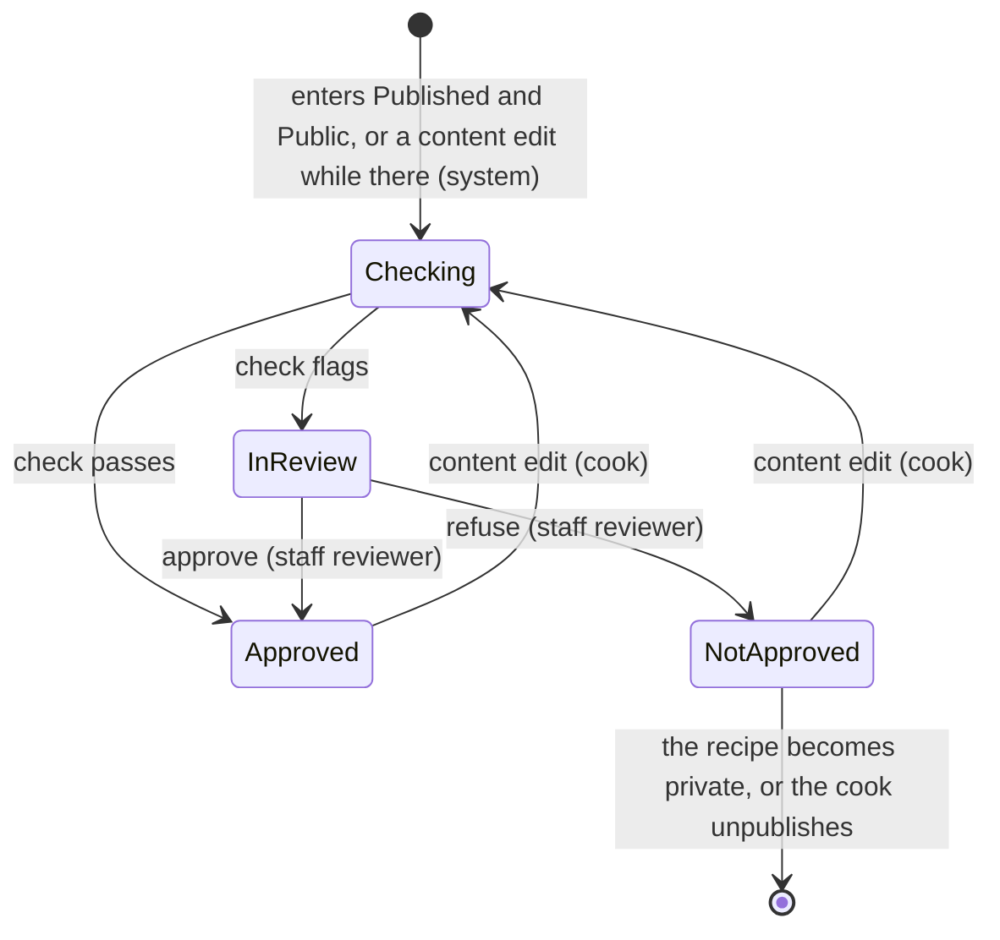

# The recipe state model

This is the one authority for what state a recipe can be in, how it moves between states, and what each state is
called. Specs and ADRs cite it and do not restate it. The decision and the rulings behind it are in
[ADR-0097](decisions/0097-a-recipe-has-one-state-model-and-only-commise-changes-a-confirmed-source.md). The same values,
labels, refusal reasons and retired names are in [`recipeStateModel.json`](recipeStateModel.json), for a later guard.
If the two differ, this document is the source and the JSON is wrong.

Rules for reading it:

- A recipe's state is a small set of independent axes. Each axis is one stored fact with a closed set of values.
- A label is the name of exactly one value, or of one named derivation. No value has two names. No name is used on
  two axes. No fact is stored twice.
- A derived fact (a lock, "open to the web", a refusal, "Adapted by you") is computed from the axes. It is never stored.
- Tokens in the first column of each value table are the model's names. They are not column values.
- The column "Enforced on main" says whether the code does this today: `yes`, `pending: P7`, `pending: P8` or
  `pending: P4`. P7 is the `fromPerson` lock. P8 is the every-answer lock together with the staff correction route.
  P4 is the difference check and the paid-site unlock.

## 1. Axes and values

### 1.1 Lifecycle (axis `lifecycle`)

| Value                 | Stored form                                         | Label | Rule                                                                                                         |
| --------------------- | --------------------------------------------------- | ----- | ------------------------------------------------------------------------------------------------------------ |
| `lifecycle.draft`     | `status = draft`                                    | Draft | A recipe the cook has not published, or has unpublished. Versions continue after a first publish (ADR-0058). |
| `lifecycle.published` | `status = published`, `first_published_at` set once |       | Needs ingredients, steps and a cuisine.                                                                      |
| `lifecycle.deleted`   | `deleted_at` set (soft)                             |       | Every read skips it. Erasure removes it.                                                                     |

"Draft" means only this axis. The unsaved copy on a device is "Unsaved changes" (derivation `derived.unsavedChanges`).

### 1.2 Audience (axis `audience`)

| Value              | Stored form            | Label   | Rule                                                                               |
| ------------------ | ---------------------- | ------- | ---------------------------------------------------------------------------------- |
| `audience.private` | `visibility = private` | Private | Only the owner reads it. A published private recipe uses a slot (ADR-0073).        |
| `audience.public`  | `visibility = public`  | Public  | Others read it when it is also published. "Make public" is an action, not a state. |

The import also offers a choice that is not an audience:

| Value               | Stored form   | Label | Rule                                                                |
| ------------------- | ------------- | ----- | ------------------------------------------------------------------- |
| `importChoice.both` | import choice | Both  | A private copy and a public version, made by the import (ADR-0072). |

### 1.3 Public check (axis `publicCheck`, spec 020)

The check runs only on a recipe that is going public or is public. A private recipe is never checked (ADR-0082 §9).
A refused write is not a state.

| Value                   | Stored form                     | Label | Rule                                     |
| ----------------------- | ------------------------------- | ----- | ---------------------------------------- |
| `publicCheck.clear`     | 020 outcome per content version |       | The check found nothing.                 |
| `publicCheck.possible`  | 020 outcome per content version |       | A person looks at it.                    |
| `publicCheck.detected`  | 020 outcome per content version |       | A person looks at it.                    |
| `publicCheck.unchecked` | 020 outcome per content version |       | No outcome yet for this content version. |

Also stored per spec 020: the referral, the clearance and the enforcement mode. What the cook sees is derived:

| Value                         | Derived from                                  | Label                     | Rule                                                                                                               |
| ----------------------------- | --------------------------------------------- | ------------------------- | ------------------------------------------------------------------------------------------------------------------ |
| `publicCheckView.checking`    | Published and Public, outcome `unchecked`     | Checking                  | Starts on entering Published and Public, and on a content edit.                                                    |
| `publicCheckView.inReview`    | outcome `possible` or `detected`, no decision | In review                 | Neither public nor private for the cook. A person decides.                                                         |
| `publicCheckView.notApproved` | a person refused                              | Not approved to be public | A state, not a source label. The recipe becomes private. It uses a slot, over the limit if need be (ADR-0073 §11). |

### 1.4 Origin (axis `origin`): where the words came from

Origin is a logical value set. Today it is stored in three columns, which the CHECKs pair so that they never hold
independent values. One field is a later change with its own ADR.

| Value                   | Stored form today                                                                           | Label                       | Rule                                                                              |
| ----------------------- | ------------------------------------------------------------------------------------------- | --------------------------- | --------------------------------------------------------------------------------- |
| `origin.own`            | `source_type = user_created`, `source_kind` null, `statement_kind = authored`               | Written by you              | The cook's "I wrote this".                                                        |
| `origin.webPage`        | `imported_public`, `source_kind = public_web`, `statement_kind = source`, `source_url`      | From a web page             | Private only until the rewritten fact is earned.                                  |
| `origin.book`           | `imported_physical`, `source_kind = book`, `statement_kind = source`, `source_attribution`  | From a cookbook or magazine | Private only until the rewritten fact is earned.                                  |
| `origin.paidSite`       | `imported_paid`, `source_kind = paid_site`, `statement_kind = source`, `source_attribution` | From a paid website         | Private only until the rewritten fact is earned. Locked until then (section 3.2). |
| `origin.person`         | `user_created`, `source_kind` null, `statement_kind = fromPerson`                           | From another person         | A family member or friend. Private only for now.                                  |
| `origin.publicDomain`   | `imported_public`, `source_kind` null (curator declared, `recipes:import:public`)           | Public domain               | Public through the check. Never a web copy.                                       |
| `origin.commiseWritten` | the Commise-written public version of a recipe                                              | Written by Commise          | Public through the check.                                                         |
| `origin.unstated`       | `user_created`, no statement                                                                |                             | No label. The cook is asked where it is from before it goes public.               |

There is no `clone` origin and no `adapted` origin. A clone has the origin and evidence of its source recipe plus the
relation in section 1.8. "Adapted by you" is a derivation (section 2).

The client also reads a newer server's unknown kind as `unrecognised`. That is a view value, not an origin: it fails
closed to private and locks the source (section 4).

### 1.5 Steps credit (axis `stepsCredit`)

Who wrote the current steps text. Stored per version when built (spec 027).

| Value                 | Stored form | Label   | Rule                                                                                                                                                                       |
| --------------------- | ----------- | ------- | -------------------------------------------------------------------------------------------------------------------------------------------------------------------------- |
| `stepsCredit.cook`    | not built   |         | The cook wrote or edited the steps.                                                                                                                                        |
| `stepsCredit.ai`      | not built   | AI line | The steps came from a kept AI rewrite or an accepted wording suggestion. The recipe shows a line under the steps saying so. The words of the line belong to the copy plan. |
| `stepsCredit.commise` | not built   |         | The steps are the Commise-written version.                                                                                                                                 |

### 1.6 Source evidence (axis `evidence`)

Append-only records. They are not a label. A record never leaves. Evidence of a third-party source keeps a recipe off
Public until the rewritten fact is earned.

| Value                     | Stored form                                   | Label | Rule                          |
| ------------------------- | --------------------------------------------- | ----- | ----------------------------- |
| `evidence.pastedPage`     | `recipe_source_evidence.capture = pastedPage` |       | A page the cook pasted.       |
| `evidence.editorLink`     | `capture = editorLink`                        |       | A link in the Source row.     |
| `evidence.editorCitation` | `capture = editorCitation`                    |       | A citation in the Source row. |
| `evidence.importFile`     | `capture = importFile`                        |       | A file import.                |

### 1.7 Rewritten fact (axis `rewrittenFact`, board P4)

| Value                        | Stored form                          | Label | Rule                                                                                         |
| ---------------------------- | ------------------------------------ | ----- | -------------------------------------------------------------------------------------------- |
| `rewrittenFact.absent`       | none                                 |       | The steps are not different enough from the source.                                          |
| `rewrittenFact.earnedByCook` | not built: check version, steps hash |       | The cook's own edit passed the difference check against the source.                          |
| `rewrittenFact.earnedByAi`   | not built: check version, steps hash |       | A kept AI rewrite passed the difference check on the kept text, measured against the source. |

The difference check is an algorithm, not AI. The AI rewriter reuses it as a feedback loop. Keeping AI text, or
accepting one suggestion, sets `stepsCredit.ai` only and earns nothing more.

### 1.8 Clone relation

`cloned_from_id`. A clone starts private, with the origin and evidence of its source. A copied "From another person"
answer keeps the clone private. The derived line is "Cloned from {cook}".

## 2. Derived facts

| Derivation               | Label              | Computed from                                                                           |
| ------------------------ | ------------------ | --------------------------------------------------------------------------------------- |
| `derived.adaptedByYou`   | Adapted by you     | a third-party origin (`webPage`, `book`, `paidSite`) plus `rewrittenFact.earnedByCook`  |
| `derived.clonedFrom`     | Cloned from {cook} | the clone relation                                                                      |
| `derived.unsavedChanges` | Unsaved changes    | the device copy differs from the saved recipe                                           |
| `derived.sourceLock`     |                    | origin, evidence, the clone relation and whether the answer is confirmed                |
| `derived.writeRefusal`   |                    | the refusal list in section 6                                                           |
| `derived.slotUse`        |                    | audience private and lifecycle published, counted live under a per-user lock (ADR-0073) |
| `derived.openToWeb`      |                    | audience, origin and the check; spec 021                                                |

With `rewrittenFact.earnedByAi`, the recipe keeps its origin label and shows the AI line. It never shows "Adapted by
you" or the ownership line for those steps. A third-party origin with the fact earned by AI goes public only as the
Commise-written page. The ownership line and a CC BY grant never cover AI-written steps. A recipe with kept AI steps is
not CC BY eligible until the cook rewrites them and the check passes against the AI text. An `own` recipe with kept AI
steps stays "Written by you" and shows the AI line.

## 3. Transitions

### 3.1 Lifecycle and audience

```mermaid
stateDiagram-v2
    state "Draft, Private" as DPr
    state "Draft, Public" as DPu
    state "Published, Private" as PPr
    state "Published, Public" as PPu
    [*] --> DPr: create draft (cook)
    [*] --> PPr: create published private (cook; publish rules; slot)
    [*] --> PPu: create published public (cook; publish rules; gate; confirmation)
    DPr --> DPu: make public (cook; gate; no slot)
    DPu --> DPr: make private (cook)
    DPr --> PPr: publish (cook; publish rules; slot)
    DPu --> PPu: publish (cook; publish rules; gate; confirmation)
    PPr --> PPu: make public (cook; gate; confirmation)
    PPu --> PPr: make private (cook; slot), or the source answer forces private
    PPu --> DPu: unpublish (cook; versions continue)
    PPr --> DPr: unpublish (cook; slot freed)
    PPu --> PPr: removed by staff
```

Every state can move to deleted (cook, or erasure). Erasure donates the recipes the cook elected, as published. A
donated recipe enters the public check like any public recipe.

Enforced on main: `yes` for every edge except removal by staff (`pending`: spec 016) and the public check (section 3.3).

### 3.2 Origin, with evidence and the rewritten fact

"Confirmed" means an explicit cook act that submits the answer: the source sheet's confirm, the first publish (a private
publish included), or a Save of a published recipe. A background checkpoint never confirms. So a never-published
draft's Source row stays the cook's to change.

| From                                                 | Event                                                               | Actor                                                                    | To                                                                     | Guard                                                                                                                                                | Enforced on main                |
| ---------------------------------------------------- | ------------------------------------------------------------------- | ------------------------------------------------------------------------ | ---------------------------------------------------------------------- | ---------------------------------------------------------------------------------------------------------------------------------------------------- | ------------------------------- |
| `origin.unstated`                                    | "I wrote this"                                                      | cook                                                                     | `origin.own`                                                           | first answer                                                                                                                                         | yes                             |
| `origin.unstated`                                    | "From a web page" with a link                                       | cook                                                                     | `origin.webPage`                                                       | evidence row; forces private                                                                                                                         | yes                             |
| `origin.unstated`                                    | "From a cookbook or magazine" with a citation                       | cook                                                                     | `origin.book`                                                          | evidence row; forces private                                                                                                                         | yes                             |
| `origin.unstated`                                    | "From a paid website" with a citation                               | cook                                                                     | `origin.paidSite`                                                      | evidence row; forces private                                                                                                                         | pending: P3                     |
| `origin.unstated`                                    | "From another person"                                               | cook                                                                     | `origin.person`                                                        | forces private                                                                                                                                       | yes                             |
| `origin.unstated`                                    | paste or detection                                                  | system                                                                   | `origin.unstated`                                                      | writes evidence and the paste fact only; Public waits for the cook's answer                                                                          | yes                             |
| `origin.unstated`                                    | curator declare                                                     | curator                                                                  | `origin.publicDomain`                                                  | scope `recipes:import:public`                                                                                                                        | yes                             |
| `origin.own`                                         | the cook states a book or a paid website                            | cook                                                                     | `origin.book` or `origin.paidSite`                                     | a citation; a free private slot unless already private; result private only; the one cook change to a confirmed answer; no edge back to `origin.own` | yes (paid website: pending: P3) |
| `origin.webPage`, `origin.book`, `origin.paidSite`   | the cook's edit passes the difference check                         | system                                                                   | origin unchanged; `rewrittenFact.earnedByCook`; shows "Adapted by you" | the check                                                                                                                                            | pending: P4                     |
| `origin.webPage`, `origin.book`, `origin.paidSite`   | the cook keeps an AI rewrite that passes the check on the kept text | system                                                                   | origin unchanged; `stepsCredit.ai`; `rewrittenFact.earnedByAi`         | the check                                                                                                                                            | pending: P4                     |
| `origin.own`, `origin.person`, `origin.publicDomain` | the cook keeps an AI rewrite                                        | cook                                                                     | origin unchanged; `stepsCredit.ai`                                     | none                                                                                                                                                 | pending: spec 027               |
| `origin.paidSite`                                    | the cook asks to move to a cookbook, with evidence                  | Commise (staff, or the system for a site Commise knows hosts a cookbook) | `origin.book`                                                          | the fact is earned, and the site hosts a cookbook or the evidence shows the recipe is from one. `book` is the only origin a paid website moves to    | pending: P4                     |
| any confirmed origin                                 | staff change                                                        | staff                                                                    | the origin staff set                                                   | recorded: who, when, old and new origin, reason. Never deletes an evidence row. Never opens Public by itself                                         | pending: P8                     |
| a public recipe                                      | clone                                                               | another cook                                                             | a new recipe with the same origin and evidence                         | the source is public; `origin.own` becomes `origin.unstated`; the "From another person" attestation is copied                                        | yes                             |
| any                                                  | erasure donate                                                      | system                                                                   | the same recipe, as published                                          | the cook elected it; skipped when a statement is owed or the recipe is from another person                                                           | yes                             |
| a third-party origin                                 | publish a public version                                            | cook                                                                     | a new linked recipe, `origin.commiseWritten`                           | spec 003B                                                                                                                                            | pending: spec 003B              |

Only Commise changes a confirmed source answer. The one exception is the cook's one-way downgrade in the row for
`origin.own`. The cook's own "another statement" and "clear" are gone.

A paid website stays `origin.paidSite` when the fact is earned. It does not change origin on its own. "Adapted by you"
is derived.

#### Edges main still allows

| Edge                                                                                                                    | Why it exists                   | Removed by                                                                                     |
| ----------------------------------------------------------------------------------------------------------------------- | ------------------------------- | ---------------------------------------------------------------------------------------------- |
| "From another person" replaced by "I wrote this" by the cook; no evidence row is left, so the recipe can then go public | ADR-0095 §4                     | pending: P7 (`yes` once P7 is on the base)                                                     |
| The cook changes or clears any other confirmed answer (`own`, `webPage`, `book`)                                        | ADR-0089 §6, ADR-0095 §3 and §4 | pending: P8, with the staff correction route. No launch build ships the lock without the route |

Order of the code follow-up: P7 first, then P8. P8 keeps the `origin.own` downgrade open and tests it.

### 3.3 Public check

The check is stored per content version, so a content edit starts it again. Making the recipe private or unpublishing
it ends it. Enforced on main: `pending: spec 020` (020 is not built; the write gate's refusals are the only guard).

## 4. Public by state

Public is decided by evidence, the rewritten fact and the checks. It is never decided by the label alone, and a change
of statement never opens a public form.

| State                                                         | Public as itself                                                                                                                    | Public form                            |
| ------------------------------------------------------------- | ----------------------------------------------------------------------------------------------------------------------------------- | -------------------------------------- |
| `origin.own`, `origin.publicDomain`, `origin.commiseWritten`  | Yes, through the check                                                                                                              | itself                                 |
| `origin.person`                                               | No, private for now                                                                                                                 | none                                   |
| `origin.webPage`, `origin.book`, rewritten fact absent        | No                                                                                                                                  | the Commise-written version            |
| `origin.webPage`, `origin.book`, `rewrittenFact.earnedByCook` | Yes, after the check: the fact lifts the evidence hold, the difference check is re-run on the published text, then the public check | itself, or the Commise-written version |
| `origin.paidSite`, rewritten fact absent                      | No                                                                                                                                  | the Commise-written version            |
| `origin.paidSite`, `rewrittenFact.earnedByCook`               | Yes, after our review finds the cook's edits sufficient, then the public check                                                      | itself, or the Commise-written version |
| a third-party origin, `rewrittenFact.earnedByAi`              | No                                                                                                                                  | the Commise-written version            |
| `origin.unstated` with a paste or evidence                    | No, until the cook gives an answer                                                                                                  | none                                   |
| a clone                                                       | as its inherited origin and evidence                                                                                                | as its origin                          |
| unrecognised kind                                             | No                                                                                                                                  | none                                   |

Enforced on main: the "No" rows are `yes`. The rows that need the rewritten fact are `pending: P4`.

## 5. Labels

One label per value. The rights label a reader sees is the origin label, or "Adapted by you" when derived. Book and
paid website have one label each. The clone line replaces the old shared rights label for clones. Labels are in the
tables above and in the JSON. Label keys in the JSON are placeholders for the copy plan.

| Value                         | Label                       | Label key                             |
| ----------------------------- | --------------------------- | ------------------------------------- |
| `lifecycle.draft`             | Draft                       | `recipeState.lifecycle.draft`         |
| `audience.private`            | Private                     | `recipeState.audience.private`        |
| `audience.public`             | Public                      | `recipeState.audience.public`         |
| `importChoice.both`           | Both                        | `recipeState.importChoice.both`       |
| `publicCheckView.checking`    | Checking                    | `recipeState.publicCheck.checking`    |
| `publicCheckView.inReview`    | In review                   | `recipeState.publicCheck.inReview`    |
| `publicCheckView.notApproved` | Not approved to be public   | `recipeState.publicCheck.notApproved` |
| `origin.own`                  | Written by you              | `recipeState.origin.own`              |
| `origin.webPage`              | From a web page             | `recipeState.origin.webPage`          |
| `origin.book`                 | From a cookbook or magazine | `recipeState.origin.book`             |
| `origin.paidSite`             | From a paid website         | `recipeState.origin.paidSite`         |
| `origin.person`               | From another person         | `recipeState.origin.person`           |
| `origin.publicDomain`         | Public domain               | `recipeState.origin.publicDomain`     |
| `origin.commiseWritten`       | Written by Commise          | `recipeState.origin.commiseWritten`   |
| `stepsCredit.ai`              | AI line                     | `recipeState.stepsCredit.ai`          |
| `derived.adaptedByYou`        | Adapted by you              | `recipeState.derived.adaptedByYou`    |
| `derived.clonedFrom`          | Cloned from {cook}          | `recipeState.derived.clonedFrom`      |
| `derived.unsavedChanges`      | Unsaved changes             | `recipeState.derived.unsavedChanges`  |

## 6. Refusal reasons

A refusal stops a write. It is not a state and never enters the public check. Eight come from the visibility decision
of the recipe service. The ninth is read only by clients.

| Reason              | Label key                               | Meaning                                                                                                              |
| ------------------- | --------------------------------------- | -------------------------------------------------------------------------------------------------------------------- |
| `policy.webPage`    | `recipeState.refusal.policyWebPage`     | A web copy is private only.                                                                                          |
| `policy.book`       | `recipeState.refusal.policyBook`        | A cookbook or magazine recipe is private only.                                                                       |
| `policy.paidSite`   | `recipeState.refusal.policyPaidSite`    | A paid-website recipe is private only.                                                                               |
| `fromPerson`        | `recipeState.refusal.fromPerson`        | A recipe from another person is private only.                                                                        |
| `statementRequired` | `recipeState.refusal.statementRequired` | Say where it is from before making it public.                                                                        |
| `sourceConflict`    | `recipeState.refusal.sourceConflict`    | Evidence of another source holds it off Public.                                                                      |
| `privateSlots`      | `recipeState.refusal.privateSlots`      | No free private slot.                                                                                                |
| `contained`         | none                                    | Refuses only test principals, so no cook meets it. It has no label.                                                  |
| `unrecognised`      | `recipeState.refusal.unrecognised`      | The client met a source or statement kind it does not know. It fails closed to private. The server never returns it. |

No reason mentions rewriting until P4 ships.

## 7. Retired names

Use the replacement. A name marked label-only is retired only as a label and stays an ordinary phrase; the copy plan
handles it as a word collision.

| Retired                                  | Use instead                                      | Label only |
| ---------------------------------------- | ------------------------------------------------ | ---------- |
| `Just for me`                            | Private                                          | no         |
| `Keep it just for me`                    | Private                                          | no         |
| `Publish privately`                      | Private                                          | no         |
| `For everyone`                           | Public                                           | no         |
| `private draft`                          | Draft                                            | yes        |
| `Not approved`                           | Not approved to be public                        | yes        |
| `Copied from a public web page`          | From a web page                                  | no         |
| `From a public web page`                 | From a web page                                  | no         |
| `Saved from`                             | From a web page                                  | yes        |
| `From a paid site`                       | From a paid website                              | no         |
| `From a cookbook, magazine or paid site` | From a cookbook or magazine; From a paid website | no         |
| `Adapted in my own words`                | Adapted by you                                   | no         |
| `Commise version`                        | Written by Commise                               | yes        |
| `public version`                         | Written by Commise                               | yes        |
| `Steps written by Commise`               | Written by Commise                               | yes        |
| `held`                                   | Waiting for you (import item only)               | yes        |
| `withdrawn`                              | one meaning per machine                          | yes        |
| `cleared`                                | one meaning per machine                          | yes        |

## 8. Statement choices

The cook's choice on the source sheet. `authored`, `publicWeb`, `book`, `fromPerson` and `paidSite` are first answers
and map to `origin.own`, `origin.webPage`, `origin.book`, `origin.person` and `origin.paidSite`. `cleared` is a staff or
legacy event. `publicConfirm` is an event, not a value.

## 9. Import item

The import item (`received`, `parsing`, `matched`, `saved`, with a held reason) is a separate machine. ADR-0072 is its
authority, and its values are not in the JSON.

## 10. Product rules from the owner (2026-11-19)

- A paid-site recipe can go public as the cook's own "Adapted by you" version when our review finds the edits
  sufficient ("Both"). An AI rewrite of it is the Commise-written page.
- An Adapted web page or book recipe goes public in its own words after the check ("Yes, after the check").
- A recipe from another person stays private for now ("Private for now").
- After a kept AI rewrite the recipe keeps its source label and shows the AI line ("Source + AI line (Rec.)").
- Only Commise changes a confirmed source answer ("Only we can change a label - not a user").
- A private recipe is not checked ("No review if private (Rec.)").
- An Adapted import stays the same recipe ("Same recipe (Rec.)").
- A confirmed "I wrote this" can still be changed by the cook to a book or paid website ("Yes, keep it (Rec.)").
- An accepted rewording suggestion follows the same AI rule ("Yes, same rule (Rec.)").
