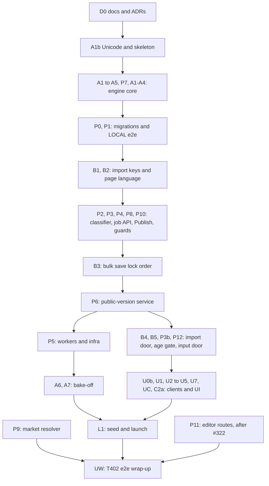

# feat: 003B Public Rewrite MVP, build order

## Summary

This plan orders the build of the 003B MVP. The design, contracts, data model and per-task tests already exist in
`specs/003B-public-rewrite/`, which stays the authority for what each task builds and tests. This plan adds only the
execution shape the owner chose on 2026-11-27: one `tasks.md` slice per build run, and each slice is one PR. That PR is
reviewed, passes CI and the CI GATE, and merges before the next slice starts.

---

## Problem Frame

003B makes a public version of an imported recipe: the steps are rewritten by Commise's step writer, with the source's
facts kept. The MVP is US1 to US5 plus the reader-market resolver (owner rulings 2026-11-21). The work is about 260
tasks in about 40 slices that span recipe-core, recipe-service, recipe-workers, infra and both apps. One PR for all of
it is too large for review and for the CI GATE. So the work follows the slices that `tasks.md` already defines.

---

## Requirements

- R1. Build every task in `tasks.md` whose slice is in the MVP, and nothing outside it (see origin:
  `specs/003B-public-rewrite/spec.md`).
- R2. Test-first for every task, in every tier the task names (CLAUDE.md, TEST-FIRST IS LAW).
- R3. Follow the owner testing rules of 2026-11-21. Unit tests are always written, and each behaviour is proved in the
  cheapest tier that proves it. Story Playwright specs and Maestro flows are written only in T402 (slice UW). Device
  runs happen once per PR, at its final head.
- R4. Each slice is its own PR, in dependency order. A slice merges before any slice that depends on it starts.
- R5. Use `~/.local/state/kitchensink/003B/buildNotes.txt` for the copy and key notes. Never use the pre-cut
  `blueprint.txt`.

---

## Scope Boundaries

- Out of scope by owner cut: US6 as a story (the classifier's open-source branch ships with US1), copies of public
  versions going public (021-FR-005), author standing, and "Make the rest public" and file-import promotion (spec 004,
  Solar Squad).
- Not edited by this feature: `packages/shared/page-reader` (another agent owns it), spec 004's text (T214 is owed to
  its squad), and any ADR outside the new 003B ADRs that T004 writes.

### Deferred to Follow-Up Work

- L2 (T150, after launch).
- T214: a text change that this plan hands to the squad that owns spec 004. It is not built here.

---

## Key Technical Decisions

- One slice per PR, merged in order. This is the owner's choice (2026-11-27). It keeps each diff small enough for the
  CI GATE, which judges per changed file, and for an Opus review round.
- Builders run on Sonnet, from the task text and the spec. Planning, review and root-cause work run on Opus, per the
  CLAUDE.md model rules.
- The spec's own Build Order and task text are authoritative. When this plan and `tasks.md` differ, `tasks.md` wins,
  and this plan is corrected.
- New ADR numbers start after the highest number on main (0100 today). The old branch `docs/003b-d0-adrs`, which was
  never merged, used 0096 and 0097, and those numbers are now taken on main, so it is not reused.

---

## High-Level Technical Design

The slice order below follows `tasks.md` "Dependencies and order" and its Implementation strategy.

---

## Implementation Units

Each unit is one or more slice PRs. The task ids, files and test scenarios are the ones `tasks.md` gives. Every unit's
tests come first, in the tiers its tasks name.

### U1. D0: docs and ADRs

**Goal:** close Phase 0 so code can start.
**Requirements:** R1, R4.
**Dependencies:** none.
**Files:** `specs/003B-public-rewrite/plan.md`, `specs/003B-public-rewrite/tasks.md`, the two new ADRs under
`docs/architecture/decisions/`, an amendment line on ADR-0072.
**Approach:**

- T001 records the built table and column names of migrations 0086 and 0088.
- T004 writes the paste-and-link import ADR and the public-versions feature ADR, plus ADR-0072's amendments.
- When the design spec's board tables carry no redraw note, T409 is marked done. Check this against the boards that
  #505 merged.
- T072, T123 and T124 ship with the slices whose phases they document.
  **Test scenarios:** `Test expectation: none (docs only). The repoGuards doc guards (adrHygiene, docCrossReferences,
specTaskIds) must pass.`
  **Verification:** Phase 0 shows every task done or handed off (T214), and the CI GATE passes.

### U2. A1b and the engine core (A1 to A5, P7, A1-A4)

**Goal:** build `RC/stepWriting/` once, with no mode flag, and the fingerprint with the skeleton fold.
**Requirements:** R1, R2.
**Dependencies:** U1.
**Files:** `packages/shared/recipe-core/src/stepWriting/` and its `__tests__/`, as T007 to T025, T166 to T172 and
T198 name.
**Approach:** land A1b before A1 closes. Land the engine alone, so that spec 027 can use it.
**Execution note:** the unit tests (marked `[P]`) come first, then the modules in the order `wordShingles`,
`factsSheet`, `factCheck`, `rewriteSteps`.
**Test scenarios:** as listed in Phase 1 of `tasks.md`, task by task.
**Verification:** every Phase 1 test passes. No consumer of `rewriteSteps` reaches a user before T353.

### U3. P0 and P1: migrations and LOCAL e2e

**Goal:** the job and credit tables, the item `channel` column, and the migrated-schema LOCAL e2e.
**Requirements:** R1, R2.
**Dependencies:** U2.
**Files:** the recipe-service migrations and schema that T026 to T033, T151, T152, T173, T174, T213, T215, T380 and
T381 name.
**Approach:** T215's migration runs before T029's.
**Test scenarios:** the LOCAL e2e asserts the migrated schema against a real database (§7.1a), and the CHECKs refuse
the rows `data-model.md` forbids.
**Verification:** the LOCAL e2e passes on a developer machine. The machine-load hook must show room first.

### U4. B1 and B2: import keys and page language

**Goal:** `sourceLinkKey` and `page_key` (B1), and `evidence.page.language` with the import evidence admission (B2).
**Requirements:** R1, R2.
**Dependencies:** U3.
**Files:** as T077, T352, T078, T081 to T084, T089, T159, T181 and T182 name.
**Test scenarios:** as listed in `tasks.md`.
**Verification:** B2 lands before P4 reads the page language, and before Phase 5.

### U5. Server: P2, P3, P4, P8, P10, then B3 and P6

**Goal:** the classifier, the job API, Publish, the copy guard, the wording guard, and the public-version service.
**Requirements:** R1, R2.
**Dependencies:** U4.
**Files:** `packages/services/recipe-service/src/` and `packages/shared/recipe-core/src/`, as Phase 3 and Phase 6
name.
**Approach:**

- Ship one PR per slice, in the order P2, P3, P4, P8, P10, B3, P6.
- B3's T314 lands before P6's T218.
- P8 carries the copy guard (T190, T403).
- P6 carries T406, T407 and T408.
  **Test scenarios:** as listed in `tasks.md`, unit and integration (database mocked) for each.
  **Verification:** each slice's unit and integration tiers pass in CI, and the service e2e passes where a task names
  one.

### U6. P5: workers and infra

**Goal:** the job worker, sweeps and alarms.
**Requirements:** R1, R2.
**Dependencies:** U5.
**Files:** `packages/services/recipe-workers/src/` and the infra that Phase 4 names.
**Test scenarios:** as listed in `tasks.md`. The `stepOf` classifier is edited in the fixed order T207, then T374.
**Verification:** the CDK synth guards pass. When alarms are off, the stage has no alarms.

### U7. A6 and A7: bake-off

**Goal:** choose the step-writer model on a private evaluation set.
**Requirements:** R1.
**Dependencies:** U6.
**Approach:**

- This needs Bedrock spend and a private evaluation set (T006) that is never committed.
- Use only non-Anthropic Bedrock models.
- Raise both points with the owner before this unit starts.
  **Test scenarios:** as listed in `tasks.md`.
  **Verification:** the bake-off result is recorded as its task states.

### U8. Import door, age gate and input door: B4, B5, P3b, P12

**Goal:** the remaining server import work, age assurance at Publish, and the input door for cook-typed public text.
**Requirements:** R1, R2.
**Dependencies:** U5.
**Files:** as Phase 6, Phase 6b and Phase 6c name.
**Test scenarios:** as listed in `tasks.md`.
**Verification:** each slice's tiers pass in CI.

### U9. Clients and UI: U0b, U1, U2 to U5, U7, UC, C2a

**Goal:** the choice, writing, review, blocked, failed and Pro screens on web and mobile, the credit and copy refusal,
and the web paste screens.
**Requirements:** R1, R2, R3, R5.
**Dependencies:** U5 and U8 for the contracts.
**Files:** `packages/apps/commise/features/recipes/src/` and the app packages that Phase 7 names, with `.native.tsx`
pairs.
**Approach:**

- Every state gets a vitest component test.
- Mobile styling uses Tamagui only (ADR-0080).
- The copy and keys come from research R8 and `buildNotes.txt`.
- Designer review before merge, per memory.
  **Test scenarios:** one component test per state, both platforms, as listed in `tasks.md`.
  **Verification:** the component tiers pass, and the designer approves screenshots.

### U10. P9 and P11: market resolver and editor routes

**Goal:** the reader-market resolver (P9), and the editor routes after PR #322 (P11).
**Requirements:** R1, R2.
**Dependencies:**

- P9 waits for spec 020's public hold and for 003A U0, U4 and U12. Those are not built today.
- P11 waits for PR #322.
  **Test scenarios:** as listed in `tasks.md`. T385 and T196 fail first, then T386, which stays red until T383.
  **Verification:** the tiers pass after the blockers land.

### U11. L1 and UW: seed, launch and the e2e wrap-up

**Goal:** seed and launch the feature (L1), then write and run every MVP story's Playwright spec and Maestro flow
(T402).
**Requirements:** R1, R3.
**Dependencies:** every other unit.
**Test scenarios:**

- T402's flows for US1 to US5.
- They run once, at the final head, through the npm e2e doors, selected by the script.
  **Verification:** the wrap-up PR's e2e passes, and device runs happen once at its final head.

---

## Risks & Dependencies

- **P9 is blocked.** 003A U0, U4 and U12 and spec 020's public hold are not built. Who builds them, and when, is
  outside this plan.
- **The bake-off costs money.** A6 and A7 need Bedrock spend and an evaluation set. The ceiling is prod-only, so
  non-prod spend has to be watched (memory "Bedrock spend non-prod").
- **The disk is small.** Each code slice needs a worktree with an install, so remove each worktree after its PR
  merges.
- **The page-reader is not ours.** Tasks that need `packages/shared/page-reader` changes wait for its owner.

---

## Sources & Research

- `specs/003B-public-rewrite/` (spec, plan, data-model, contracts, tasks, research, agentNotes), on main at 4f20d8921
  or later.
- `~/.local/state/kitchensink/003B/buildNotes.txt` for the copy and key notes, outside the repo.
- The owner rulings of 2026-11-21 (MVP scope, testing rules) and 2026-11-27 (one slice per lfg run).
